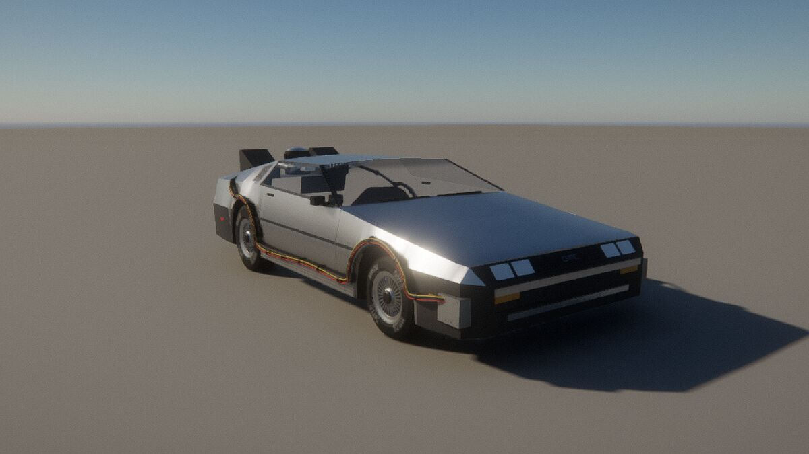
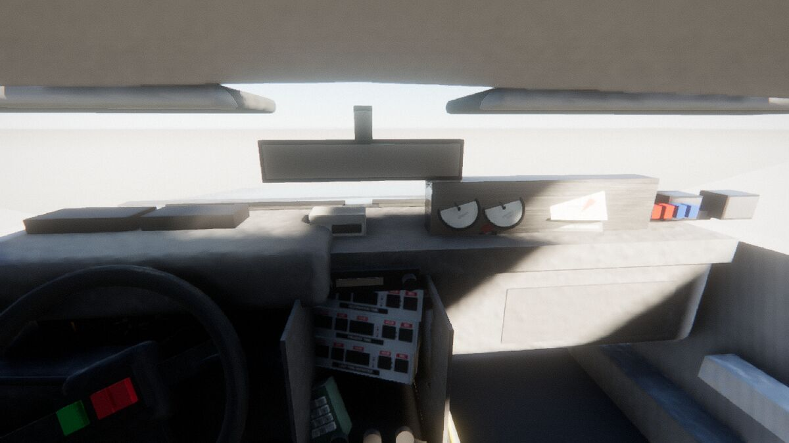
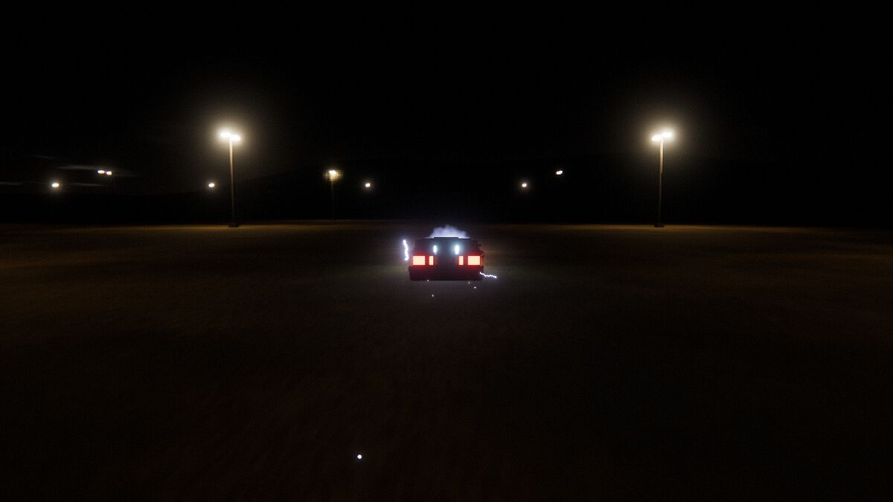
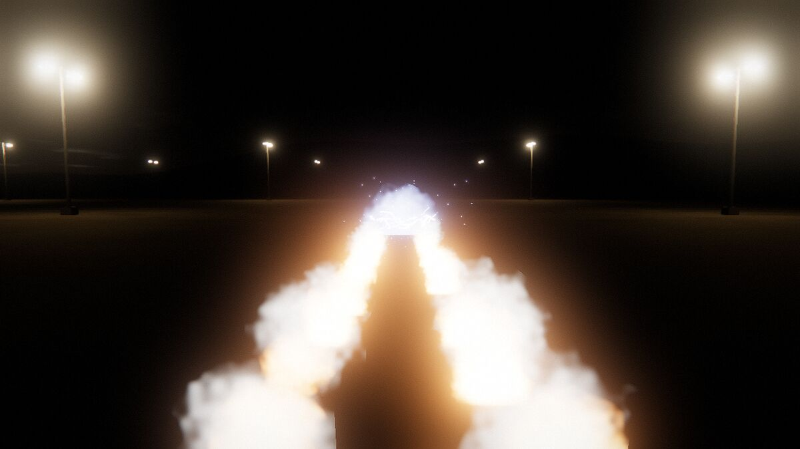
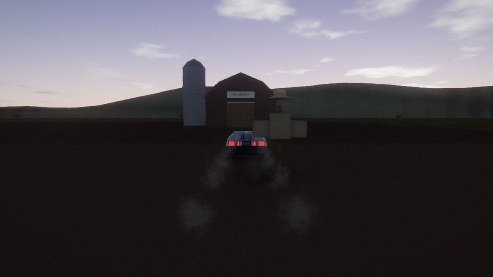
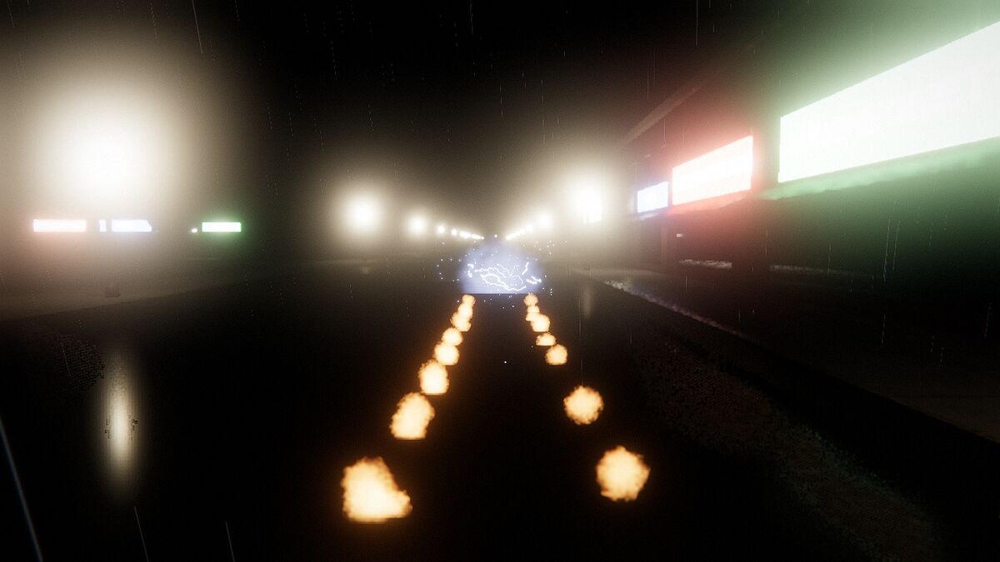

# Time Machine

The DeLorean time machine from *Back to the Future*: a 1981 DMC-12 with Doc Brown's
conversion, outside and in, which you drive and take through time. Set the destination on the
keypad, switch on the time circuits and bring her up to 88 miles per hour. The coils light up,
the car vanishes in three flashes and leaves two trails of fire, and it arrives at the
destination time in the same place, covered in frost.

It runs on the Med Engine, the WebGL2 deferred renderer of *Zweikampf 1403* (`games/duel1403`,
imported read-only), with the sky, glass, night vision and effects passes of its own.

| The time machine | Inside: the time circuits, the keypad, Doc's meters |
| --- | --- |
|  |  |
| **Coming up on 88: the coils arc** | **Gone: the fire trails** |
|  |  |
| **5 November 1955, 6 AM: Peabody's farm** | **12 November 1955, 10:04 PM: down Main Street on the lightning** |
|  |  |

## Play

```bash
cd games/delorean
npm install
npm run dev              # http://127.0.0.1:5178
npm run build:single     # one self-contained page: dist-single/time-machine.html
npm test                 # the car's performance, the time circuits, the calendar, the sky
```

The start screen offers four moments:

| | When | |
| --- | --- | --- |
| Twin Pines Mall | Sat 26 Oct 1985, 1:20 AM | The empty parking lot. The circuits are set for 5 November 1955, 6:00 AM. |
| Hill Valley, 1955 | Sat 12 Nov 1955, 10:01 PM | The storm. No plutonium: only the lightning at 10:04 can get you home. |
| Hill Valley, 2015 | Wed 21 Oct 2015, 4:28 PM | The last minute of rain. Mr. Fusion on the back. |
| Hill Valley, 1885 | Wed 2 Sep 1885, 8:00 AM | Dirt streets; the courthouse going up, its clock not yet hung. |

| Key | |
| --- | --- |
| W / ↑ | accelerator |
| S / ↓ | brake; hold it at a stop for reverse |
| A D / ← → | steer |
| Space | handbrake |
| T | the time circuits on or off (the lever by the gear stick) |
| K | the keypad: digits 0–9 type, Enter sets, Backspace clears |
| F | load a plutonium pellet (stopped), or feed Mr. Fusion |
| C | view: driver, chase, orbit, passenger |
| Mouse / drag | look round; the wheel zooms outside |
| L | headlamps: off, dipped, main |
| G / J | open or shut the left / right gull-wing door |
| M | automatic or manual; Q / E change down / up |
| R | on the night of the storm: back to the end of Main Street for another run |
| N | sound · P pause · + / − the clock faster or slower · H the keys |

On a phone the left half of the screen steers (drag sideways), the pedals are bottom right and
the buttons along the top.

The address can set things directly (for testing): `?go=1&t=1955-11-12T22:01&dest=1985-10-26T01:24&empty=1&cam=chase&tc=1`,
`ver=part2` for Mr. Fusion, `q=low|high`, `speed=80`. `?dev=car&view=dash` shows the car on a
turntable (`front34 side rear34 front rear top cabin dash petersen`).

## The time machine

**The rule** (`src/time/timecircuits.js`). With the time circuits on, a destination set and
1.21 gigawatts at the flux capacitor, reaching 88 mph displaces the car to the destination time
at the same place. Afterwards PRESENT TIME shows where you are and LAST TIME DEPARTED the moment
you left. Typing works as on the prop: month, day, year, hour (0–23) and minute fill the
destination field by field, and a complete, valid entry is set. An impossible date (30 February)
blinks and is refused, and a date alone means midnight. The power comes from:

- **Plutonium.** The chamber holds one charge and a jump empties it. Doc's case holds one spare
  pellet. Load it with F at a stop.
- **Mr. Fusion** (Part II). Feed it household waste for a charge whenever you like.
- **Lightning.** The bolt delivers 1.21 GW once, if it hits the hook while the car passes at 88.

**The jump** (`src/time/travel.js`). From about 68 mph the coils glow and the vents shimmer.
Over 80 the blue arcs crawl over the body. At 88 come three white flashes and the implosion,
then the car is gone. Two trails of fire burn along the last metres of its track, with the
sonic boom. On arrival come three flashes and a boom; the car is frosted ("cold, damn cold"),
the vents steam, and the frost melts off the glass and the stainless over a minute or two.

**The night of the storm** (`src/time/lightning.js`, `src/world/rig.js`). Rain, flashes in the
clouds, and thunder arriving at the speed of sound. Doc's cable runs from the lightning rod on
the courthouse tower past the clock, across the square to a lamp post, and across Main Street
at the height of the hook on the pole on the back of the car. At 10:04:00 PM the bolt hits the
rod, the current runs down the cable and the clock stops for thirty years. Be under the cable
at 88 mph within half a second of the strike, with the circuits on and set for home, and the
charge goes to the flux capacitor. Miss it and the bolt won't strike there again (R resets).
The car starts at the end of Main Street with about three minutes to spare; the HUD counts down.

**Changing history** (`src/time/timeline.js`). Hill Valley is built from the year you are in,
and from what you did in earlier years. In 1955 Old Man Peabody's farm has two young pines by
the gate. Run one down, come back to 1985, and Twin Pines Mall is Lone Pine Mall.

## What works in the car

The DMC-12 itself (`src/car/body.js`, `details.js`, `wheels.js`):

- The brushed stainless body over its true lines: the wedge, the waist crease, the louvred
  rear deck and the black bumpers.
- The gull-wing doors on their roof hinge, with their glass.
- The four rectangular headlamps, the ribbed tail lamps and the DMC grille letters.
- The turbine wheels: 14-inch at the front, 15-inch at the back, on Goodyear Eagle GTs.

Doc's conversion (`src/car/timemachine.js`, Part I):

- The reactor over the engine, with its finned drum and the hubcap lid.
- The two vents at the back with their coils, and the flux bands along the sides.
- The capacitors, heat sinks, conduit and wires round the arches, and the boxes on the corners.
- The OUTATIME plate and, for the storm, the pole and hook.

Part II swaps the reactor for Mr. Fusion.

Inside (`src/car/interior.js`), everything that works in the film works here:

| Instrument | What it does |
| --- | --- |
| Time circuits (three rows) | Destination, present and last departed, in red, green and amber 14- and 7-segment displays at their real brightness, with the AM/PM lamps and the blinking colon. The destination blinks on a bad entry. |
| Keypad | The green box by the wheel. Each key travels in when pressed and plays its tone. |
| Time circuits switch | The lever by the gear stick flips over and the displays come on. |
| Digital speedometer | The white readout on the dash, on with the circuits. |
| Flux capacitor | The Y of glass tubes behind the seats. Its lights run in to the centre, faster as it fluxes harder near 88. |
| Doc's meters | On the passenger side: PRIMARY, POWER and the plutonium chamber's ROENTGENS needle. EMPTY blinks when there is no charge. The row of red and blue lamps glows with the circuits and flashes when armed. |
| Switch pod | The green and red rockers on the wheel hub, turning with the wheel. |
| DMC dials | 85 mph speedometer (it pegs past 85, as in the film), tachometer, coolant temperature, fuel, volts and oil pressure. All run from the engine model and light at night. |
| Gear lever | Moves through the five-speed gate as the gears change. |
| Steering wheel | Turns sixteen times the road wheels. |
| Lights | Headlamps, brake, reverse and indicators, with physical intensities. The headlamps light the road and the street. |

Some switches have a function the films never show; those got a plausible job rather than
nothing.

## What is simulated

**The car** (`src/physics/vehicle.js`). A planar rigid body on four Pacejka tyres, at 1 kHz,
with:

- The PRV V6's torque curve (2.85 L, 130 hp).
- A clutch and the five-speed's real ratios (3.364 / 2.059 / 1.381 / 1.057 / 0.820, R 3.182,
  final drive 3.444).
- 1290 kg (the car's 1233 kg and an estimate for Doc's hardware), 35/65 front to rear with the engine behind the rear axle; drag Cd 0.36 on 1.92 m²; rolling resistance.
- Surfaces: asphalt, wet asphalt, concrete, dirt, grass and ploughed fields, each with its own grip and rolling resistance.
- Collisions with the buildings, lamp posts and trees.

The tests hold it to the period figures: 0–60 mph in about 9 s, a top speed near 130 mph, and
88 mph about 450 m after a standing start.

**The sky and the light** (`src/astro.js`, `src/render/sky.js`, `src/render/stage.js`).

- The sun from NOAA's algorithm and the moon from Meeus, with its phase and brightness, for
  Hill Valley's latitude on the real date. The stars turn with sidereal time, and the Milky
  Way is in place.
- A physically based sky lit by both, with California's daylight-saving rules back to 1918.
- At night the eye goes mesopic and loses colour.
- The town's glow on the clouds changes with the era: faint oil lamps in 1885, incandescent in 1955, sodium in 1985 and 2015.

**The world** (`src/world/`). An invented Hill Valley, laid out from the films:

- The courthouse with its clock tower and the square, and Main Street's storefronts, with the
  names and signs of each era.
- The county road out to Peabody's farm, which becomes the Twin Pines Mall and its parking lot.
- Street lamps and oaks, and the rain and wet roads of the storm and of 2015.

**The sound** (`src/audio/sound.js`). Everything is synthesised:

- The V6, with the tyres, wind and squeal.
- The rising whine and crackle near 88, the three booms and the hiss of the vents.
- The keypad's tones, the doors and the thunder.
- Crickets on the farm.

## Sources

The car

- en.wikipedia, *DeLorean time machine*: the parts of the conversion, Part I to III. https://en.wikipedia.org/wiki/DeLorean_time_machine
- en.wikipedia, *DMC DeLorean*: dimensions, the PRV engine, the gearbox, weight. https://en.wikipedia.org/wiki/DMC_DeLorean
- Rook's Castle, *Building a time machine*: the prop's parts and where they sit. https://www.rookscastle.com/tutorials/time5.html
- Sandstone Productions, *How does Doc Brown's DeLorean work?* https://www.sandstoneproductions.co.uk/blogtothefuture/2021/5/8/the-time-machine-how-does-doc-browns-delorean-work-
- Specifications: Ultimate Specs, Unique Cars and Parts, Supercars.net, carsales. https://www.ultimatespecs.com/car-specs/Delorean/17644/Delorean-DMC-12-.html · https://www.uniquecarsandparts.com.au/specifications/delorean/1981_de_lorean_dmc_12 · https://www.supercars.net/blog/delorean-dmc-12 · https://www.carsales.com.au/research/delorean/dmc-12/1981/no-badge
- Auction listings with detailed photographs of the DMC-12's cabin and body: PCARMARKET, Collector Car Canada, Carrozzieri Italiani. https://www.pcarmarket.com/auction/1982-delorean-dmc-12-5-speed/ · https://collectorcarcanada.ca/auctions/sold-by-auction-1981-delorean-dmc-12/ · https://www.carrozzieri-italiani.com/listing/delorean-dmc-12/
- The OUTATIME plate: The Prop Gallery, Topreg. https://www.thepropgallery.com/delorean-barcode-licence-plate · https://www.topreg.co.uk/news/car-number-plates-from-famous-films/

Reference photographs (Wikimedia Commons)

- *1981 DeLorean DMC-12 Time Machine, Petersen Automotive Museum.* https://commons.wikimedia.org/wiki/File:1981_DeLorean_DMC-12_Time_Machine_Petersen_Automotive_Museum.jpg
- *Back to the Future Time Machine Dashboard.* https://commons.wikimedia.org/wiki/File:Back_to_the_Future_Time_Machine_Dashboard.jpg
- *DeLorean DMC-12 Time Machine's time circuits.* https://commons.wikimedia.org/wiki/File:DeLorean_DMC-12_Time_Machine%27s_time_circuits.JPG
- TeamTimeCar.com, *BTTF DeLorean Time Machine* (photographs by Oto Godfrey and J. Morton), 03 and 07. https://commons.wikimedia.org/wiki/File:TeamTimeCar.com-BTTF_DeLorean_Time_Machine-OtoGodfrey.com-JMortonPhoto.com-03.jpg · https://commons.wikimedia.org/wiki/File:TeamTimeCar.com-BTTF_DeLorean_Time_Machine-OtoGodfrey.com-JMortonPhoto.com-07.jpg
- *DeLorean DMC-12 Front.* https://commons.wikimedia.org/wiki/File:DeLorean_DMC-12_Front.jpg

The films

- *Back to the Future* (1985), *Part II* (1989) and *Part III* (1990), Universal Pictures. The
  dates, times and places of the scenarios, the storm and the cable, the frost, the fire trails
  and the Twin Pines / Lone Pine change are as in the films.

Physics and the sky

- Pacejka, *Tire and Vehicle Dynamics* (the Magic Formula).
- NOAA, solar position calculation. https://gml.noaa.gov/grad/solcalc/calcdetails.html
- Meeus, *Astronomical Algorithms* (1998): the moon's position and phase.
- Hillaire (2020), *A Scalable and Production Ready Sky and Atmosphere Rendering Technique*.
- California Uniform Time Act history (daylight saving since 1918, the war years, 1949 on).

*Back to the Future*, the DeLorean time machine and OUTATIME are Universal's. This is a fan
recreation for study and fun, not for sale.
