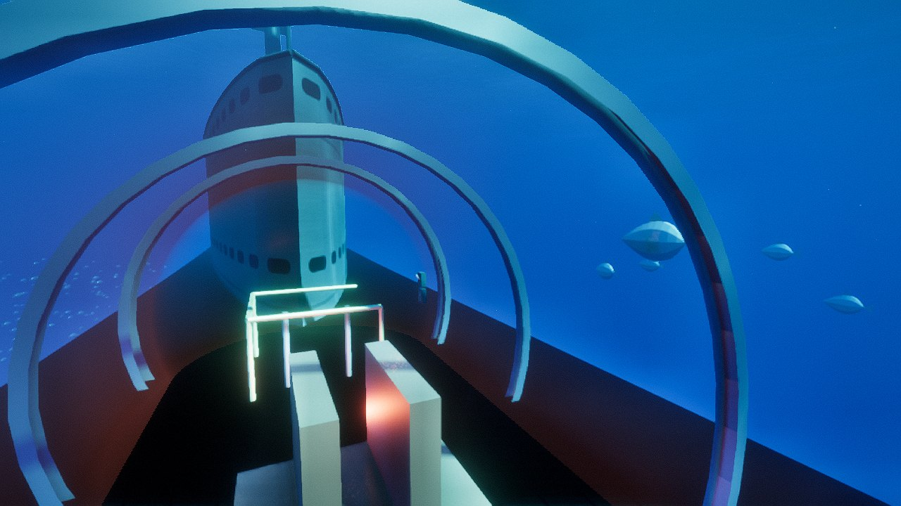
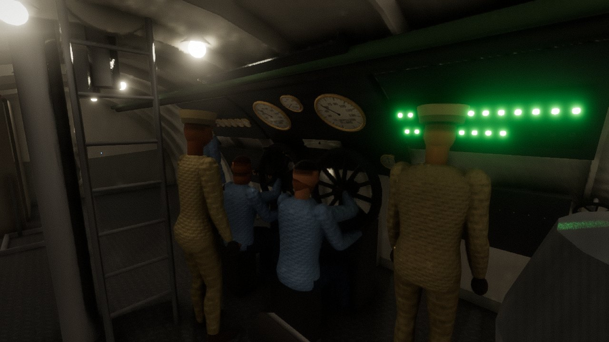
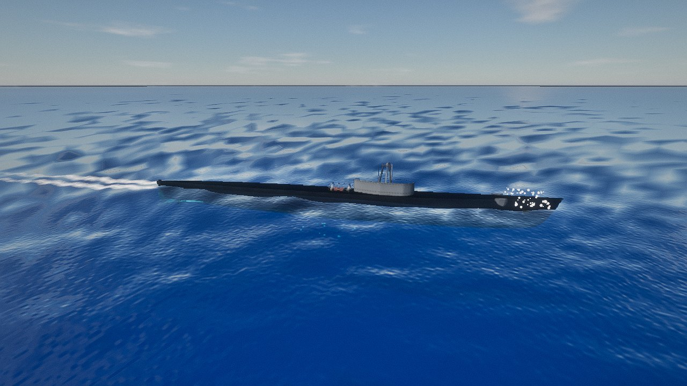
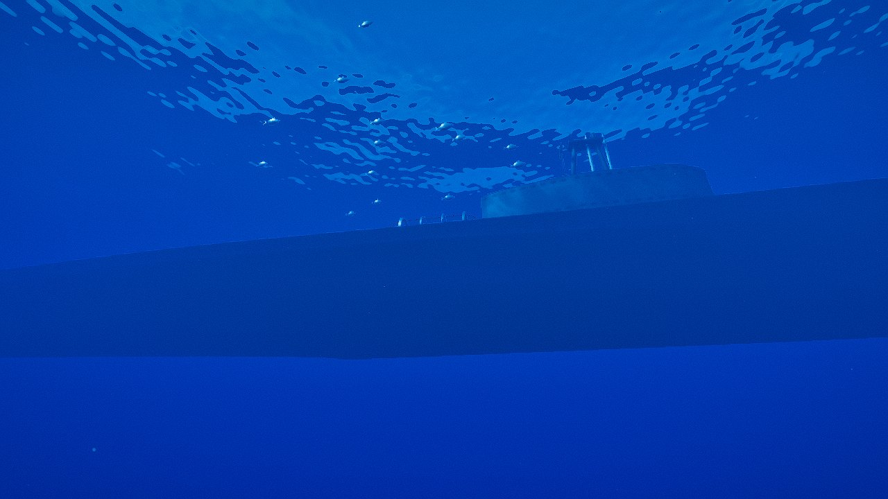
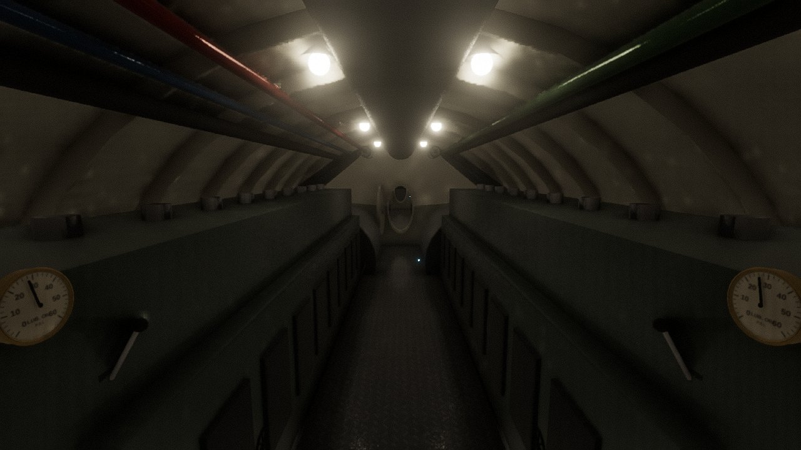

# Fleet Boat

Thursday 15 October 2026, a mile and a half off Waianae on Oahu's leeward coast. A Balao-class
fleet submarine of 1943, kept going as a heritage boat, has been refitted for her owner (you).
Her torpedoes and her 4-inch gun are ashore. Where the gun stood, an acrylic observation deck
sits in a steel saddle on her deck, reached by a trunk from the crew's mess. Her crew of 76
(seven officers and sixty-nine men, her wartime complement) run her as she was run in 1944.

Everything in her is worked by hand. The vents open because the chief of the boat throws their
levers on the hydraulic manifold. The planes move because two men sit at their wheels and turn
them, watching the depth gauges and the bubble. The diesels start because a motor machinist's
mate primes the lube oil, opens the sea suction and the exhausts, and puts the lever to START.
Nothing else moves them. Give the captain an order and watch the crew carry it out. Or go below
and put your own hands on her valves.

It runs on the Med Engine, the WebGL2 deferred renderer of *Zweikampf 1403* (`games/duel1403`,
imported read-only), set up the way *Gotthard Pullman* set it up. The crew are the 1403 game's
figures, dressed by Gotthard's figure code in dungarees and khaki.

| From the observation deck at periscope depth | The diving station: the planesmen at their wheels |
| --- | --- |
|  |  |
| **On the surface off Waianae** | **Submerged, from the sea** |
|  |  |



## Board her

```bash
cd games/fleetboat
npm install
npm run dev              # http://127.0.0.1:5178
npm test                 # the physics against the books, and the crew's dive and surfacing
npm run patrol           # a forenoon at sea, headless: orders, the crew's reports, her state
```

Add `?start=submerged` (at periscope depth on the battery) or `?start=diesels` (surfaced, two
engines on propulsion) to the address to begin there instead of surfaced and rigged for diving.

| Key | |
| --- | --- |
| Mouse | look round: click the view to hold the mouse (Esc lets go), or drag |
| W A S D | walk the boat (Shift: hurry); the watertight doors stand open at sea |
| E | up or down a ladder: the trunk from your deck to the crew's mess, to the conning tower, the bridge (when the hatch is open), the pump room |
| Look at a control | left button: open a valve, turn a wheel, throw a lever to its next position, switch on; right button: the other way |
| Tab | orders to the captain: dive (60, 150, 300 ft), surface, depth, speed (the telegraph's bells), course, the diesels, rig for red or white, time |
| E at a periscope | in the conning tower, with the periscope up: look through it (mouse to train it, F for 1.5 or 6 power, E to step back) |
| V | step outside and look at her from any side, above or under the sea |
| + / − | time faster or slower (the physics keeps its 60 steps a second of boat time) |
| P · T · H | pause · the words on the screen · the keys |

## What she is

The boat is USS *Pampanito*'s class, after her **General Information Book** (Portsmouth Navy
Yard, SS-381 to 404, 1943) and the Navy's training manual **Fleet Type Submarine** (NavPers
16160, 1946). Wherever a number exists in them, it is theirs. That covers the frame spacing,
compartments and doors, every tank's capacity and centre, the weights in normal diving trim, and
the drafts, displacement and stability. It also covers the engines, generators, motors,
batteries and propellers, the air banks, the hydraulic accumulator, the planes and the rudder, and
the test depth. Positions inside the compartments are estimates from the manual's photographs and
cutaway drawings.

### The hull in the sea (`src/physics`)

- **Archimedes, slice by slice.** The outer hull is a family of superellipse sections whose eleven
  parameters were fitted (`tools/fithull.mjs`, Nelder–Mead) to the yard's figures. Those are:
  1,806 tons surfaced at 15 ft 3 in, 2,419 tons submerged, the centre of buoyancy, the waterplane
  area, BM, the wetted surface and the midship section. Buoyancy is integrated over 64 slices
  against the actual wave surface and the sea's density at each slice's depth. The boat you
  see is drawn from the same sections, except at the bow: the fit ends square, so the drawn hull
  curves up from the forefoot into the raked stem of the outboard profile.
- **The sea water** is UNESCO's EOS-80 (density with salinity, temperature and pressure), with
  Mackenzie's sound speed and Sharqawy's viscosity. The water column off Oahu in October has a warm
  mixed layer over the thermocline. Pressure is integrated down the column (P = ρgh), so the
  boat feels the denser water under the layer.
- **Ballast tanks** hold air and water. In the main ballast tanks the water stands where the air's
  pressure (Boyle: pV = nRT) plus the column inside balances the sea at the flood ports. Open
  the vents and the sea comes in as fast as the air can leave. Blow them and the air drives the
  water out, and spills from the ports once the tank is dry. Coming up with the vents shut, the
  air expands and empties them by itself. Safety, negative and the fuel ballast tanks flood
  through valves (Torricelli). The variable tanks have no sea connection: only the trim pump
  moves their water.
- **Air** is real gas, with the compressibility of air at 3,000 psi. Five banks feed the
  high-pressure manifold, and two hammer valves feed the 600-lb blowing manifold, whose pressure
  is solved each step from what flows in and out (choked flow at 0.528). There is the 10-lb
  low-pressure blower, the bleed into the boat, and starting air for the engines.
- **Six degrees of freedom.** Kirchhoff's equations carry the full rigid-body mass matrix with the
  centre of gravity wherever the water, fuel and crew put it, plus strip-theory added mass.
  Slender-body lift with flow separation on the tapering stern gives the Munk moment. Viscous
  cross-flow drags each section. Resistance is the ITTC-57 friction line from the Reynolds
  number, with a form factor and wave-making that fades as she goes deeper. The bow and stern
  planes, the rudder, the skeg and the fairwater are finite wings that stall, and the stern
  surfaces sit in the screws' race. The screws follow B-series KT/KQ curves with a four-quadrant
  table for backing.
- **Calibrated to the records.** Surfaced, four engines make 20.2 knots at 282 rpm (the class did
  20¼ on 5,400 shp). Submerged, on a weakened field, she makes 8.9 knots on 2,890 shp (the book
  says 8¾ on 2,740). Her turning circles match the Batfish trials, and a quick dive reaches
  periscope depth in 27 to 29 seconds.

### The plant (`src/physics/plant.js` and the rest)

Every control in `src/data/controls.js` has a value put there by a hand. The plant reads nothing
else:

- **The hydraulic manifold's levers** drive rams on the vents, the flood valves and the main
  induction. They take seconds and draw oil from the accumulator, which the IMO pumps recharge.
  The planes and the rudder follow their wheels at the rams' speed.
- **The electric drive is a network.** Two batteries (126 cells each, a kinetic battery model
  fitted to the yard's discharge rates), four generators and four motors are connected by the
  maneuvering room's cubicle. Its ten levers set the reverse, the starters (series or parallel
  with starting resistance), the generators, the battery and the bus. It is solved by Kirchhoff
  each step, with field rheostats, a lagging series field, overload breakers and reverse-current
  relays. Charging gasses hydrogen above 2.35 volts a cell.
- **The diesels.** Fairbanks-Morse 38D 8-1/8, ten cylinders, opposed piston, two-stroke, 1,600 bhp
  at 720 rpm. They start on air and fire above about 110 rpm, and the governor holds the speed.
  The fuel comes from the yard's consumption table. They breathe the boat's air (shut the
  induction and the barometer falls), they need an open exhaust, and they need the sea suction or
  the jacket water climbs past 180 °F. Start one without priming the lube oil and the bearings
  wear.
- **The trim and drain systems.** The trim manifold has a suction and a discharge valve for every
  tank and the sea. The centrifugal trim pump (primed first) runs in parallel or series, on pump
  curves. "Flood auxiliary from sea" works through the stopped pump. The drain pump takes the
  bilges.
- **The boat's air: Dalton and Henry.** The crew breathe 35,000 cubic feet of it, oxygen in and
  CO2 out (77 men at rest reach 3 % CO2 in about 17 hours; the yard said 18.2). There is the
  absorbent, the oxygen flasks, the hydrogen from the battery wells, the bleed and the vents.
  Five Haldane compartments track the nitrogen taken up in the crew's tissues.
- **Flooding.** Every hull opening has its area: the main induction, the engine exhausts, the
  hatches and the hull ventilation. Open one under water and the sea comes in (Torricelli), runs
  through open doors over the sills, and weighs where it lies. Diving with the main induction
  open floods the engine rooms, as it did USS *Squalus* in 1939. Past the test depth the hull
  weeps. At about 900 ft the plating's hoop stress (σ = pr/t on 7/8-inch high-tensile steel)
  reaches yield.

### The crew (`src/crew`)

The complement comes from the General Information Book, each man with his rate and a station for
each condition: the surfaced watch, the submerged watch, and diving stations, after the manual's
bill. At the diving alarm the lookouts drop down the ladder to the planes and the officer of the
deck goes to the conning tower.

Each man walks the boat at a man's pace, through the doors and up and down the ladders. He works
controls with two hands. A hand reaches a control in the time Fitts' law gives, then turns a
handwheel a turn or so a second, throws a lever in half a second, or turns a big wheel 12 degrees
a second. One hand does one job at a time. A control out of his reach, he steps over to.

Some watchstanders work continuously:

- **The bow planesman** holds the ordered depth from the depth gauge and how fast its needle moves.
- **The stern planesman** holds the angle on the boat from the bubble.
- **The helmsman** steers by the gyro repeater.
- **The controllermen** answer the telegraph's bells. On the battery they work the starters, the
  reverse levers (with the starter at STOP: the interlock) and the motor fields. On the diesels
  they work the generator fields, never past the ammeter's rating, and hold the charging current.
- **The quartermaster** watches the fathometer and the bilges.

The procedures in `src/crew/procedures.js` are the manual's chapter 18, step by step. Each step
waits on what the men can see: a gauge, the Christmas tree, a report.

- **Dive.** "Clear the bridge!", two blasts. The induction and the hull ventilation are shut, the
  vents opened, the bow planes rigged out, a down angle put on. The quartermaster dogs the hatch
  ("Hatch secured!"), the Christmas tree goes green ("Straight board"), and air is bled into the
  boat to prove her tight ("Pressure in the boat, holding"). At 40 ft they blow negative to the
  mark, shut its flood and vent it inboard. They level off, shut the vents, and the diving officer
  trims her: he watches what the planes must do and pumps or floods a few hundred gallons at a
  time.
- **Surface.** Three blasts, a short blow (Boyle's expansion and the blower do the rest), and the
  quartermaster cracks the hatch. The low-pressure blower runs until the lookouts see air bubbling
  alongside.
- **The diesels.** Starting them, putting generators on the motor bus or charging the battery,
  and shifting to the battery.
- **The periscopes.** They run up on their hoists (the General Information Book's heights: the
  head 47 ft 2½ in above the keel housed, the optics 66 ft 5½ in raised). The captain puts one up
  at periscope depth and down before going deeper or surfacing. At 60 ft keel depth the head
  stands 6½ ft above the sea.

### The world (`src/world`, `src/render`)

- **The sea floor** off Waianae: the fringing reef, the sand shelf with its patch reefs, the
  island's flank going down to the deep.
- **The waves** are a Pierson–Moskowitz spectrum for the trade wind in a dozen Airy components.
  The boat floats in them and the surface you see is drawn from the same ones.
- **The waves she makes** are solved, not drawn (`src/world/wake.js`). The free surface is
  potential flow (Laplace's equation in the water, the inviscid limit of Navier–Stokes),
  linearised and solved spectrally on a 256 m square that travels with her. Each mode runs at its
  deep-water frequency, so the Kelvin wedge, the bow and stern waves and their wavelengths come
  out of the equations. The hull forces it as a moving pressure (Havelock); a submerged hull's
  effect fades as exp(−kd) with its depth.
- **Breaking and spray.** Faces that steepen towards the Stokes limit break and leave foam,
  which fades over seconds; the screws' wash whitens the water astern. The wind sea breaks at its
  crests as often as Monahan's whitecap coverage gives for the wind. The bow throws spray when she
  drives into a sea, most when she slams into one. A raised periscope trails its feather. The
  drops fall under gravity and air drag until they meet the sea.
- **The light under the sea.** The sun's beam is refracted at the surface (n = 1.333) and dimmed by
  Beer–Lambert, separately for red, green and blue, in clear Jerlov type I water: red is gone
  within 10 m, blue reaches 100 m. The waves' caustics play near the surface. Every view ray is
  attenuated and coloured by its path through the water, not through the boat or the acrylic.
  The surface from below shows Snell's window. The eye adapts to the blue, as a diver's does.
- **Inside the hull** there is no daylight. Each compartment is lit by its lamps along the
  overhead and the light the white paint throws back. The control room and conning tower go red
  at night.
- **Life.** Schools of scad and trevally (some pace the boat off your deck), reef fish, Hawaiian
  green sea turtles, spinner dolphins. Bubbles leave the vents and the flood ports and swell as
  they rise (Boyle). Marine snow drifts past the acrylic.
- **The sound** is synthesized from the plant, with nothing recorded: the diesels' firing note
  (rpm/60 × 10), the motors' hum, the klaxon, the vents' roar, the hiss of a blow, the pumps and
  blowers, the telegraph's bell, and the hull's creaks as the pressure changes. Each is heard
  through the boat's doors from where it is.

## Sources

- *General Information Book, U.S.S. Pampanito (SS-383)*, Portsmouth Navy Yard, 1943 (the class SS-381 to 404): hull and tank data, weights, stability, machinery, the complement. San Francisco Maritime National Park Association, maritime.org.
- *The Fleet Type Submarine*, NavPers 16160, Bureau of Naval Personnel, 1946: chapters 1 (general), 3 (the compartments, with photographs), 4 (ballast tanks), 5–7 (air, trim and drain, ventilation), 10–12 (the hydraulic system), 14 (main propulsion control), 18 (diving and surfacing, trim). maritime.org/doc/fleetsub.
- *The Fleet Type Submarine Main Propulsion Diesels*, NavPers 16161, 1946, and the Fairbanks-Morse 38D 8-1/8 data in the General Information Book: the engine, its starting, lube, cooling and fuel consumption.
- Fofonoff, N. P. & Millard, R. C., *Algorithms for computation of fundamental properties of seawater*, UNESCO Technical Papers in Marine Science 44, 1983 (EOS-80).
- Mackenzie, K. V., "Nine-term equation for sound speed in the oceans", *J. Acoust. Soc. Am.* 70, 1981.
- Sharqawy, M. H., Lienhard, J. H. & Zubair, S. M., "Thermophysical properties of seawater", *Desalination and Water Treatment* 16, 2010.
- Locarnini, R. A. et al., *World Ocean Atlas 2018*, NOAA: the temperature and salinity profile near 21° N 158° W.
- Fossen, T. I., *Handbook of Marine Craft Hydrodynamics and Motion Control*, Wiley, 2011: the six-degree-of-freedom equations, added mass, cross-flow drag.
- ITTC, *Proceedings of the 8th International Towing Tank Conference*, 1957: the friction line.
- Oosterveld, M. W. C. & van Oossanen, P., "Further computer-analyzed data of the Wageningen B-screw series", *International Shipbuilding Progress* 22, 1975; Roddy, R. F., Hess, D. E. & Faller, W., *Neural network predictions of the 4-quadrant Wageningen propeller series*, NSWCCD, 2006.
- Manwell, J. F. & McGowan, J. G., "Lead acid battery storage model for hybrid energy systems", *Solar Energy* 50, 1993 (the kinetic battery model).
- Pierson, W. J. & Moskowitz, L., "A proposed spectral form for fully developed wind seas", *J. Geophys. Res.* 69, 1964.
- Jerlov, N. G., *Marine Optics*, Elsevier, 1976; Smith, R. C. & Baker, K. S., "Optical properties of the clearest natural waters", *Applied Optics* 20, 1981; Morel, A., "Optical modeling of the upper ocean", *J. Geophys. Res.* 93, 1988.
- Bühlmann, A. A., *Decompression–Decompression Sickness*, Springer, 1984 (tissue compartments and Haldane's method).
- Card, S. K., Moran, T. P. & Newell, A., *The Psychology of Human-Computer Interaction*, 1983 (Fitts' law constants).
- Meeus, J., *Astronomical Algorithms*, 1998, via NOAA's solar position calculator (the sun over Oahu, in Gotthard Pullman's `sun.js`).
- Naval Court of Inquiry, *Loss of USS Squalus*, 1939: the main induction open on a dive.

## The code

```
src/data        boat.js (the books' numbers), layout.js (decks, ladders, doors), controls.js (every control)
src/physics     seawater, gas, hull, tanks, air, dynamics, propeller, mass, electric, diesel,
                hydraulics, trim, atmosphere, flooding, plant (all of it worked by its controls)
src/crew        roster (who and where), person (feet and hands), crew (watches, the planesmen,
                helm and controllermen), procedures (chapter 18)
src/world       sea (waves), seabed (Waianae)
src/render      stage (the Med Engine, lit for a submarine), hull, interior, fittings, controls,
                instruments, crew, life, surface, acrylic, particles
src/audio       sound.js
tools           shot.mjs (headless screenshots), patrol.mjs (a forenoon at sea), fithull.mjs
tests           physics.test.js, crew.test.js
```
