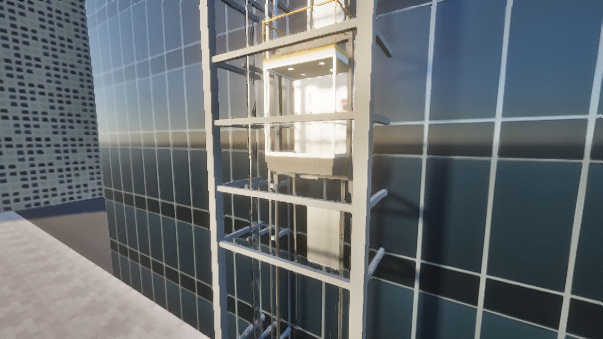
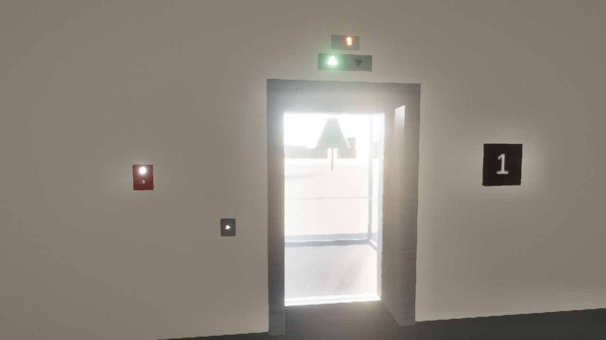
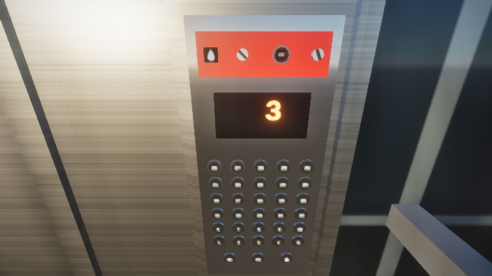

# Glass Elevator

Tuesday 27 October 2026, early afternoon on the Stockholm waterfront. A glass lift runs up the
south face of a 30-storey office tower, outside the curtain wall, in an open steel hoistway. It is
a 1600 kg, 4.0 m/s gearless traction elevator with its machine room on the roof. Everything that
makes a modern elevator work is modelled and has to work for this one to work, and every button,
switch, key and lever can be worked by hand.

It runs on the Med Engine, the WebGL2 deferred renderer of *Zweikampf 1403* (`games/duel1403`,
imported read-only), set up the way *Gotthard Pullman* and *Fleet Boat* set it up, with
Gotthard's sky and sun.

| Riding up at 4 m/s, looking south over the water | The car in its hoistway on the tower's face |
| --- | --- |
|  |  |
| **The lobby: the car has answered the hall call** | **The car operating panel** |
|  |  |

## Ride it

```bash
cd games/glass-elevator
npm install
npm run dev              # http://127.0.0.1:5180
npm test                 # the physics against the code, and the controller's logic
npm run build:single     # one self-contained page: dist-single/glass-elevator.html
```

| Key | |
| --- | --- |
| Mouse | look round: click the view to hold the mouse (Esc lets go), or drag |
| W A S D | walk (Shift: hurry) |
| Left button | press a button, flip a switch, turn a key. **Hold** on a loose thing to pick it up (wheel: nearer or further, right button: throw it). Hold on a door panel or the brake release lever and drag |
| E · Q | at a stairs door, up or down a floor (from floor 30, up to the machine room); the pit door and the pit ladder |
| G (or the Go to button) | the lobby, the car, its roof, any floor, the machine room, the pit, the plaza |
| V | step outside and watch: drag, wheel, W and S to go up and down the hoistway, F to follow the car |
| T | the engineer's panel: drive, ropes, traction, brakes, governor, buffers, load, doors, the safety chain switch by switch |
| + / − · P · H | time faster or slower · pause · the keys |

On a phone or tablet: the stick walks, dragging looks, **Use** is your hand (tap a button, hold to carry or pull; look round to move what you hold), with Throw, E, Q, View, Go to and Data beside it.

## What is modelled

All the numbers are in `src/data/spec.js`. Where a rule exists (EN 81-20 and EN 81-50 mostly,
ASME A17.1 for firefighters' service), the test suite checks the design against it.

### The hoist (`src/physics/hoist.js`, 1000 steps a second)

- **The car and the counterweight hang on eight 13 mm ropes** over a 640 mm traction sheave
  (49 rope diameters) and a deflector. The counterweight is the car plus 45 % of the rated load
  (2820 kg). The ropes are springs, EA / L for the length on each side. The car sits 4 cm lower at
  the lobby with full load than empty, and bounces on its ropes at about 1.6 Hz down there and
  11 Hz at the top. Rope safety factor: 15 with full load at the lobby (at least 12 required).
- **Traction is friction.** Each step the friction the grooves must give the ropes is compared
  with what an undercut U-groove can give (Euler-Eytelwein, T1/T2 ≤ e^(fα), with EN 81-50's
  groove factor and a 160° wrap). Beyond it the ropes slide. So the car holds 125 % load at the
  lobby, and when the counterweight lands on its buffer the ropes slip and the car can't be
  hauled further up, as the code requires.
- **Rope weight and compensation.** 4.7 kg a metre of rope hangs on whichever side is longer. Four
  compensating ropes under the car and the counterweight hang the same weight the other way,
  round a 1000 kg tension sheave in the pit. That sheave has a tie-down (anti-rebound device),
  which the code requires above about 3.5 m/s.
- **The machine:** a gearless permanent-magnet motor (20 poles, 119 rpm at 4 m/s, 3.8 kN·m rated,
  6.8 kN·m peak) with the rotor's inertia and two independent brake sets clamping the sheave.
  Either brake set alone stops the car with rated load going down at rated speed. A hand release
  lever in the machine room lets you lift the brakes a little at a time.
- **The overspeed governor** is driven by its rope from the car. At 4.40 m/s its switch opens the
  safety chain. At 4.80 m/s (between 115 % of rated speed and 1.25 v + 0.25 / v) its jaws grip the
  rope. The rope then lifts the progressive safety gear's linkage on the descending car, and the
  wedges stop it on the rails at about 0.5 gn.
- **Oil buffers** under the car and the counterweight have a 1.10 m stroke (the code's minimum is
  0.0674 v² = 1.08 m). A metering pin makes a 115 % speed strike a uniform 1 gn stop. A weight
  resting on an oil buffer sinks through it, as on a real one.
- **Guides:** roller guides on the car, sliding shoes on the counterweight, both with friction.

### The drive (`src/physics/drive.js`)

A regenerative VVVF drive, modelled as three loops:

- **Motion profile:** a time-optimal S-curve (jerk 1.2 m/s³, acceleration 1.0 m/s², 4.0 m/s). It
  brakes the moment the shortest jerk-limited stop reaches the target, then re-solves the
  deceleration each step so the stop lands on the floor.
- **Position and speed loops** on the motor encoder, with the load's unbalance fed forward as
  pre-torque before the brakes lift.
- **The current loop**, as a lag.

The target allows for the ropes stretching less as they shorten on the way up. In the last 15 cm,
a levelling sensor reads the car's true height against the floor magnets. The car stops within
about 2 mm. A full trip from the lobby to floor 30 takes 34 s, and the energy going back to the
grid is counted.

### The doors (`src/physics/doors.js`)

- **Car door:** a centre-opening glass door on its operator. The thrust is held to 150 N, and the
  closing speed is set so the moving mass carries under 10 J at the average closing speed
  (measured: about 9 J).
- **Coupling:** at a floor the car door's vanes engage the landing door's rollers and lift its
  interlock.
- **Landing doors** close themselves on a closing weight and lock. The triangle key in each door
  head lifts the lock from the landing side.
- **Car door lock:** away from a floor the car door is locked (the hoistway is open). Within the
  unlocking zone you can push it open by hand.
- **Reopening:** a 32-beam light curtain sees anything in the doorway, including you and the
  boxes. A door that stalls on something reopens. After 20 s of being held, the doors nudge shut
  slowly with a buzzer.

### The controller (`src/control/controller.js`)

- **The safety chain:** every safety switch in series. That means the machine room, pit and car
  roof stop switches, the governor, both buffers, both final limits, the safety gear, the
  compensation sheave, the car door contact and the 30 landing door locks. Open any of them and
  the brakes drop wherever the car is.
- **Start and stop sequences:** contactors, magnetising, pre-torque, brakes lifted and seen to
  lift; on arrival, zero speed held, brakes dropped, torque off.
- **Selective collective dispatching:** answers calls in passing order, reverses at the last call,
  and passes hall calls when 80 % full.
- **Load and doors:** overload at 110 % keeps the doors open and sounds the buzzer. The doors
  pre-open while the car levels. Double-pressing a lit car call cancels it.
- **Re-levelling** at 0.1 m/s with the doors open, when loading has stretched the ropes by over
  10 mm.
- **Unintended movement protection:** the car leaving the door zone with its door open locks the
  elevator out.
- **Inspection:** from the car roof, hold-to-run at 0.3 m/s.
- **Emergency electrical operation** from the machine room. It bypasses the governor, safety gear,
  buffer and final limit switches, so a stuck car can be freed.
- **Firefighters' service:** Phase I recall to the lobby (the lobby key) and Phase II from the car
  (constant-pressure doors, call cancel).
- **Also:** independent service, parking at the lobby, the alarm button, and the automatic rescue
  device. When the mains fail it waits, moves the car in the light-load direction to the nearest
  floor on its battery, and opens the doors.

### Everything you can lay hands on

- **The car:** 30 floor buttons, door open and close, alarm, the Phase II key, call cancel, the
  independent service key.
- **The lobbies:** every hall button on 30 floors, the Phase I key at the lobby, the triangle
  keyhole in every landing door.
- **The car roof:** the inspection switch, UP, COMMON and DOWN, the STOP switch.
- **The pit:** the STOP switch.
- **The machine room:**
  - the main switch, the stop switch, emergency electrical operation and its UP, RUN and DOWN
    buttons;
  - the governor test trip and reset, fault reset, the automatic rescue switch, parking;
  - the brake release lever.
- **The simulator's own failures** (the yellow panel in the machine room): cut the mains, fail
  both brake linings, make the drive run away, blind the light curtain, part all eight hoist
  ropes. A repair button puts everything back.
- **Loose things you can pick up, throw, stack, push, wheel into the car or drop down the
  hoistway:**
  - In the lobby: three 600 kg test-weight carts on castors (all three in the car is 1800 kg, an
    overload), six 25 kg test weights, cardboard boxes, a suitcase, a football, a cone, a potted
    plant, a chair.
  - Elsewhere: a toolbox and a can of rope grease in the machine room, a bucket in the pit, a box
    on floor 30.

- **The lift engineer's tools** (`src/world/tools.js`), on the technician's trolley in the lobby. Click one to put it on your tool belt; R uses the chosen tool on what you look at, X puts it down, 1-9 choose:
  - hoistway door key (the triangle keyholes need it), door wedge, pry bar (forces a door, and bends its interlock: out of service until mended);
  - spanner set (mends a forced lock, re-hangs parted ropes, resets the governor), brake linings, multimeter (finds the open contact in the safety chain), service laptop (clears the drive's encoder fault and the controller's faults), screwdriver (realigns the light curtain);
  - lockout padlock and tag for the main switch: rope and brake work is refused until it is locked off, as lockout/tagout requires;
  - rescue rope and harness: anchor it in an open (or pried) landing door, lower yourself down the hoistway onto the car roof (back: down, forward: up), and climb back out the same way.

  They are rigid bodies (`src/physics/bodies.js`). Whatever stands in the car presses on its
  floor, and the load weighing reads it: your own 80 kg too.

## Tests

`npm test` runs these checks:

- the design against the code: governor trip window, buffer stroke, rope safety factor, D/d;
- traction: 125 % load holds, and the ropes slip with the counterweight on its buffer;
- trips: peak speed, flight time, levelling within ±10 mm, no slip;
- re-levelling after loading: ≤ 0.3 m/s, back within 10 mm;
- door kinetic energy;
- overload;
- brake failure → governor → safety gear between 0.2 and 1 gn;
- one brake set alone stopping rated load;
- the ropes parting;
- a 600 kg cart weighed in the car and carried up;
- collective dispatching order;
- Phase I recall;
- the inspection stop;
- the automatic rescue.

## Sources consulted

- EN 81-20 buffer stroke and governor tripping speed: the [Northampton journal paper](https://journals.northampton.ac.uk/index.php/tsib/article/download/173/115/828) and [Oleo's buffer brochure](https://www.oleo.co.uk/media/brochures/oleo-elevator-english/files/basic-html/page6.html).
- Door kinetic energy and force limits: [EP1544152](https://patents.google.com/patent/EP1544152B1/de), the [Avire light curtain datasheet](https://www.avire-global.com/wp-content/uploads/2023/07/E-Series-EN81-20-Datasheet-V11-GB.pdf) and the [lift door force paper](https://liftescalatorlibrary.org/paper_indexing/papers/00000504.pdf).
- Traction and groove friction: [Fred Hymans and the theory of rope traction](https://elevatorworld.com/?p=26460) and [On Friction for Traction of Elevators](https://liftescalatorlibrary.org/paper_indexing/abstract_pages/00000362.html).
- Gearless machines and 2:1 / 1:1 roping: [TK Elevator](https://www.tkelevator.com/us-en/company/insights/what-is-a-gearless-traction-elevator.html).
- Compensation and anti-rebound devices: [US6431321](https://patents.google.com/patent/US6431321) and [Prysmian's compensating cable note](https://nz.prysmian.com/sites/nz.prysmian.com/files/media/documents/Tech-Tip-1.pdf).
- Re-levelling speeds: [US10676316](https://patents.google.com/patent/US10676316).
- Firefighters' service: the [IUEC alert on Phase II operation](https://iuec.org/wp-content/uploads/IUEC-Codes-Standards-Alert-Phase-II-Operation-1-1.pdf) and the [TSSA FEO checklist](https://www.tssa.org/downloads/feo-checklist-new).
- Panoramic car glazing: [California Title 8 §3010](https://dir.ca.gov/title8/3010.html) and [Elevator World's "Panoramic Car Safety"](https://elevatorworld.com/?p=18003).
- Ride quality measurement: [ISO 18738-1](https://www.iso.org/standard/33586.html).

The standards themselves were not read. Where only a secondary source was found, the value used
is the one commonly quoted (for example the 10 mm re-levelling trigger and ±10 mm stopping
accuracy).
