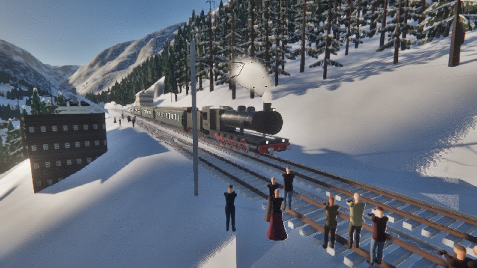
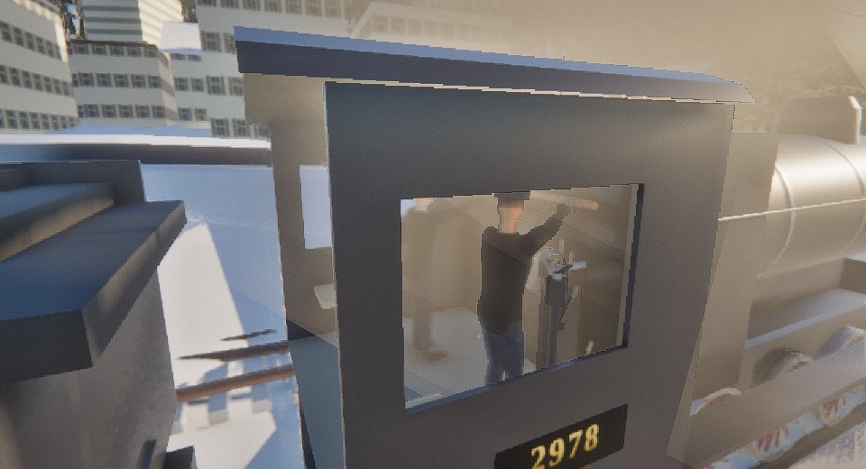
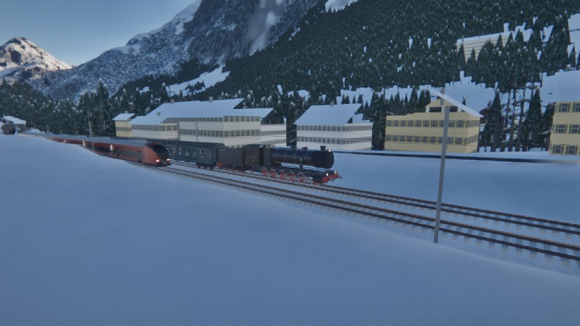
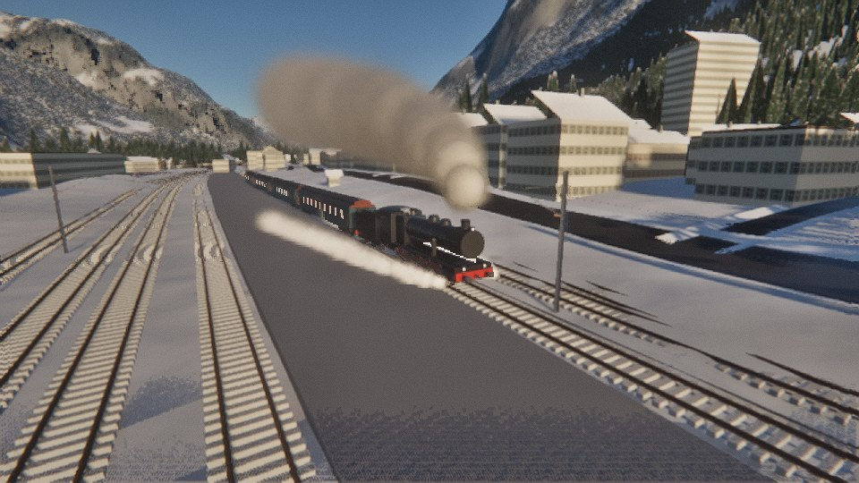
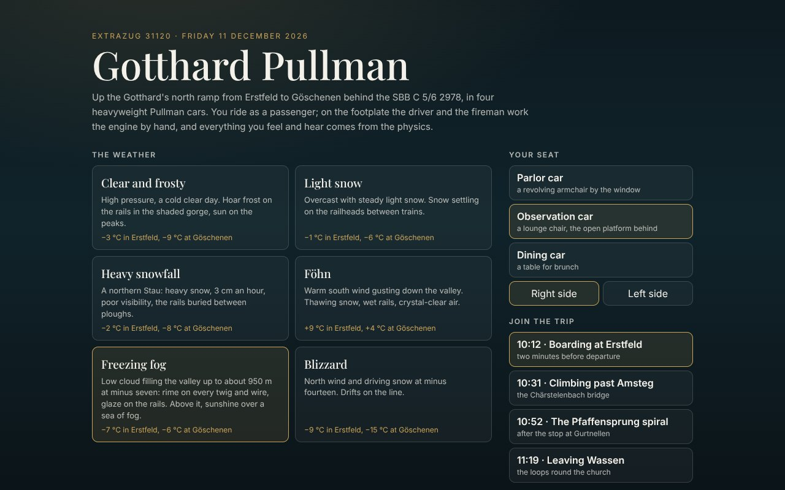

# Gotthard Pullman

Friday 11 December 2026. A steam special, Extrazug 31120, climbs the Gotthard's north ramp from
Erstfeld to Göschenen behind the SBB C 5/6 2978 "Elefant", with four heavyweight steel Pullman
cars in dark blue-green: a sleeper, a diner, a parlor car and an observation car. You ride as a
passenger, in a revolving armchair by the window. The driver and the fireman work the engine by
hand, and the other passengers get on and off at the stops. You feel the car sway and see the
snow gather on the window sill. You hear each exhaust beat come back along the train and watch
the valley change as the line climbs through the spiral tunnels.

It runs on the Med Engine, the WebGL2 deferred renderer of *Zweikampf 1403* (`games/duel1403`,
imported read-only). Its people are the 1403 game's figures, dressed for 2026.

| The photo stop at Wassen | On the footplate: the driver at the injector valve |
| --- | --- |
|  |  |
| **Overtaken at Gurtnellen by the Treno Gottardo** | **The exhaust in the frosty air** |
|  |  |



## Ride

```bash
cd games/gotthard-pullman
npm install
npm run dev              # http://127.0.0.1:5176
npm run trip -- clear    # the whole trip headless: the crew drives, the timetable is kept or not
npm test                 # physics and people checks
```

The start screen offers six weathers, three seats (parlor, observation or dining car, right or
left side), four points to join the trip, and the picture quality.

| Key | |
| --- | --- |
| Mouse | look around: click the view to hold the mouse (Esc releases it), or drag |
| E | get up and walk the train: W A S D (Shift quicker), through the gangways, out onto the observation platform; E by your seat to sit down |
| V | step outside and orbit the train (drag; wheel to zoom; `[` `]` change vehicle) |
| M | your phone: the map of the line with the train's blue dot (wheel to zoom) |
| + / − | time faster or slower (the physics keeps up at 240 Hz) |
| P | pause |
| N | sound on or off |
| T | the travel card (time, place, next stop, delay) |
| F3 | the physics of the engine and the train |
| H | the keys |
| F | on the footplate: take over and drive the engine yourself (F again hands back to the driver) |

**Driving.** Press F and you are at the driver's side of the cab, at his controls. The physics is
the same; only the hand on the controls is yours:

| Key | Control |
| --- | --- |
| W / S | regulator open / close (hold) |
| Q / A | reversing screw: wind into forward gear / back (hold); full gear is 75 % cut-off |
| ] / [ | train brake valve one notch on / off: release, running, lap, service 0–100 %, emergency |
| Backspace | emergency brake |
| . / , | direct (engine) brake on / off (hold) |
| G | starting valve: live steam to the low-pressure cylinders for a heavy start (hold) |
| X | sanders (hold) |
| C | cylinder drain cocks open / shut (open them while she is cold, shut them once running) |
| I | right-hand injector on / off (the fireman still minds the left one, the fire and the blower) |
| J | train steam heating on / off |
| Space | whistle (hold) |
| K | acknowledge a Signum warning |

The backhead gauges read the simulation:

- boiler pressure (red line at 15 bar);
- the low-pressure receiver;
- the duplex air gauge (main reservoir and brake pipe);
- the engine's brake cylinder;
- the train-heating pipe;
- the Hasler speed recorder (0–90 km/h).

The gauge glasses show the water level, swinging with the grade and the brakes. On a phone, a
Drive button and a button panel do the same.

Drive as the real crew had to. Brake hard with a low glass and the water runs off the firebox
crown: hold that long enough and the fusible plug melts, and she is finished. On the 26 ‰ bank a
450 t restart is at the limit of adhesion. Ease the start with sand, full gear and the starting
valve. The signals are real: a red signal stops you.

The address can set everything directly (for testing): `?w=fog&q=high&t=10:52&car=observation&chair=5`
(weathers `clear snowfall heavy foehn fog blizzard`; `cam=out&veh=0&dist=20` starts outside).

## The trip

| Stop | Booked | Why |
| --- | --- | --- |
| Erstfeld (472 m) | dep 10:14 | boarding; the last passengers are still on the platform when you arrive |
| Gurtnellen (738 m) | 10:38 – 10:49 | waits on the loop to be overtaken by the hourly Treno Gottardo |
| Wassen (936 m) | 11:06 – 11:18 | photo stop below the church; most passengers get out |
| Göschenen (1106 m) | arr 11:34 | end of the journey at the summit tunnel's portal |

The train number is invented. Amsteg-Silenen, Gurtnellen and Wassen lost their passenger trains
long ago (Wassen in 2001); the special uses them as a heritage train would.

## What is simulated

**The engine** (`src/physics/locomotive.js`). The C 5/6 is a four-cylinder compound. Steam flows
through the regulator to the high-pressure cylinders, then to the receiver and the low-pressure
cylinders. Each cylinder end works through admission, cut-off, expansion, release and
compression (real steam: IAPWS-IF97 tables in `steamtables.js`). The exhaust goes up the blast
pipe, its draught pulls air through the fire, and the fire burns coal and boils water. The model
covers the safety valves, injectors, blower, sanders, starting valve and drain cocks. The driving
wheels have their own rotational degree of freedom against the rail. Adhesion is a creep-force
curve whose peak friction (μ) depends on the rail's state: dry, damp, wet, frost, ice or snow.
Sand raises μ. Exceed it and the engine slips.

**The train** (`src/physics/train.js`, `brakes.js`). Each vehicle is a mass with Newton's second law
and spring-damper couplings with buffer contact between vehicles. Resistances:

- Gravity on the real gradients, up to 26 ‰.
- Davis rolling resistance, raised in frost.
- Röckl curve resistance in the 280–300 m curves.
- Aerodynamic drag in the air's real density at each altitude, with the wind, and higher inside
  tunnels.

The Westinghouse-type air brake runs in the brake pipe at about 250 m/s, with each vehicle's
brake cylinder and the blocks heating up. Each passenger's 80 kg is added to the car they board.

**The crew** (`src/crew/`). Nothing on the footplate moves by itself. A hand travels to each
control in a time set by Fitts' law, then works it at a human rate. The driver opens the
regulator gradually, notches up the reverser, sands on frost, catches slips, whistles for tunnels
and stations, and brakes in stages for the stops. The fireman fires a round of shovelfuls by the
pressure and the fire and keeps the water over the crown sheet. The banker is called if the
train stalls.

**The passengers** (`src/people/passengers.js`). About sixty people with seats. Each walks the
aisle, waits a turn on the steep vestibule steps, crosses the platform and stands out at the
photo stop, away from the other main line. The conductor gets on last and gives the right away
only when everyone is aboard. Once under way, the conductor goes through the train for the
tickets, and each passenger turns and holds up a phone. Seated, people look out, talk, read,
doze, drink coffee in the diner, and photograph the gorges from the window. You can get up
too: walk the aisles and corridors, through the gangways, out onto the observation car's open
platform.

**The other trains** (`src/world/traffic.js`). The hourly Treno Gottardo is the Südostbahn's
copper-red "Traverso": eight articulated cars, 150.2 m. Going south it overtakes the special at
Gurtnellen on the other main line, crossing over before the station and back after; the
Gotthard's double track is signalled for either direction. The northbound one comes down past
the Wassen photo stop. Their speed follows the curves and the grade, and their driver gives the
steam train a toot. Their times are estimates.

**The signals** (`src/world/signals.js`, `src/render/signalsGL.js`). SBB "System L" light
signals on both main lines:

- An entry signal before each station and an exit signal after it.
- Block signals between stations, at most about 3.5 km apart.
- A distant signal 900 m before each main signal.

A main signal shows red "Halt" while the section beyond it is occupied, or at a station until
the special's booked departure with everyone aboard; otherwise it shows green "Fahrt". A distant
signal shows two orange lights "Warnung" or two green lights "Fahrt".

Integra-Signum protects the train, as on 2978. Passing a distant signal at Warnung, you have 4 s
to acknowledge (K), or the brakes go on. Passing a red signal brakes the train at once. The
Treno Gottardo runs live under the same signals, so it waits behind the special if it has to.
The signals' exact positions are estimates by those rules, as the line's signalling plans were
not available.

**Wheels and rails** (`src/render/wheel.js`, `src/render/track.js`). The wheels have real
tyres:

- back-to-back 1360 mm;
- a 32 mm flange inside the rail head, 28 mm deep;
- a 135 mm tread coned 1 in 40, whose rolling circle sits on the rail's centre line.

The rails are UIC 60, leaning in 1:40 on concrete sleepers in ballast. The coned treads steer
each wheelset: on the straight it hunts gently from side to side (Klingel's sinusoid, about 23 m
long). In the line's tight curves it runs out until the outer flange meets the outer rail. The
engine's pony truck swings on its pivot to follow the curve while the coupled wheels stay in the
frame.

In the curves the track, the cars and the engine lean in with the cant (the outer rail higher), up to 141 mm on the 252 m
curves. On top of that, the unbalanced part of the curve's pull rolls each body a little outward
on its springs. The platforms stand 1.65 m from the track's centre plus a 45/R widening in
curves, and their top is 55 cm over the rail along their whole length.

Where tracks part, there are turnouts:

- switch blades, planed to a point, lie against the stock rails; the set route's blades are
  closed and the others stand open by the 110 mm throw;
- a point machine sits beside the toe;
- the inner rails cross at the frog, with check rails opposite.

The steel-on-steel contact itself is in the physics: low rolling resistance, and the adhesion
creep curve at the drivers.

**Derailment** (`src/physics/derail.js`). Nothing holds a vehicle to the track but its wheels'
flanges and its own weight. Every step, every vehicle is checked for the two ways a wheelset
leaves the rails:

- **Overturning.** The lateral load the track must supply shifts the weight onto the outer
  wheels. That load comes from the curve's pull not balanced by the cant, the crosswind, and the
  couplings, which push the ends outward in a curve when buffing and pull them in when drawing.
  When the inner wheels carry nothing, the vehicle goes over. On the 252 m curves with 141 mm
  cant that happens at about 120 km/h.
- **Flange climb** (Nadal's limit, Y/Q = 1.34 for a 70° flange and μ = 0.3). It comes from big
  sideways pulls, such as a derailed neighbour dragging on its coupling, or heavy buffing in a
  curve.

A train also comes off at the end of the line, and in a collision with another train on the
same rails. The Treno Gottardo is solid, at about 290 t (estimate), and the two share their
momentum.

Once off the rails, a vehicle is a free body:

- It slides on its wheels over the sleepers and ballast (μ ≈ 0.35), or on its side (μ ≈ 0.55).
- It is pulled about by its couplings, which tear at about 1.2 MN.
- It trips over when it slides sideways, because the ground's friction at its feet works
  against its inertia high up.
- A tunnel's walls hold it in the bore.
- It falls off a bridge or down an embankment, onto the terrain.

The brake hoses tear, so every brake goes on, and the crew shut off steam. Wreckage fouling the
other main line occupies it, so its signals go to Halt.

**The ride** (`src/physics/sway.js`). Track irregularities come from a PSD-shaped spectrum
(alignment, level, cross-level) passed through each car's body modes (lateral and roll ~0.8 Hz,
bounce ~1.2 Hz, pitch ~1.5 Hz). The player's head lags those accelerations.

**The weather** (`src/world/weather.js`). Air temperature by altitude, wind, falling snow, rail
condition and visibility. Each preset is a typical December day for the valley.

**The steam** (`src/render/steam.js`). Each exhaust beat leaves the chimney as a few turbulent
thermals:

- They entrain the air, so their size grows with their path while their momentum spreads over
  the growing mass.
- They rise while the dilution leaves them buoyant.
- They condense or evaporate along the mixing line between the hot exhaust and the air's
  saturation deficit.
- Their opacity is that of fine droplets, and light diffuses through the plume, which also
  shadows itself.

So the plume hangs in freezing fog and vanishes a few metres up in the dry föhn.

**The world.** Terrain comes from the Copernicus 30 m DEM, with 5 m tiles carved for the
formation, cuttings, walls and tunnel portals. Land cover is from ESA WorldCover. Forests are
species by altitude, and the snow line follows the weather. The track, catenary, tunnels and
bridges are built from the line's geometry. Buildings, roads, the Reuss and the platforms come
from OpenStreetMap/Overture. The houses follow the valley's ways: plaster in several colours with
shutters, or dark log storeys on a whitewashed masonry ground floor, and barns on stone footings.
The Reuss takes its width from the mapped banks. Light comes from the sun's true position for the
date (NOAA), a physically based sky, the mountains' shadows and the sky the gorge leaves. Inside
the cars, daylight enters only through the windows and the clerestory's deck lights. The glass
gathers snow, frost and grime.

**The cars.** The parlor and lounge armchairs are overstuffed, revolving on brass pedestals,
with a linen cloth over the head of the back. The diner has mahogany chairs with leather seats.
The vestibule doors open on the platform side while people get on and off, and shut before the
right away.

**The sound** (`src/audio/sound.js`). Everything is synthesised from the physics:

- Chuffs from the exhaust beats, delayed by the 343 m/s journey back along the train.
- The whistle, safety valves, blower and air pump.
- Wheel rumble with the speed, flange squeal in tight curves, and the brake blocks before a
  stand.
- The panelling creaking with the sway and the murmur of the passengers.
- A tunnel's reverberation.

## Sources

The line, the stations and the structures

- de.wikipedia, *Gotthardbahn*: tunnels and stations, the 26 ‰ ramps. https://de.wikipedia.org/wiki/Gotthardbahn
- en.wikipedia, *Gotthard railway*. https://en.wikipedia.org/wiki/Gotthard_railway
- de.wikipedia, *Chärstelenbachbrücke*: the order south of Amsteg (Windgällentunnel, the bridge at km 47.9, Bristentunnel). https://de.wikipedia.org/wiki/Ch%C3%A4rstelenbachbr%C3%BCcke
- Röll, *Enzyklopädie des Eisenbahnwesens* (1912), "Gotthardbahn": the spiral tunnels' lengths. http://www.zeno.org/Roell-1912/A/Gotthardbahn
- Schienenverkehr Schweiz, the line Luzern/Zug – Chiasso and Bahnhof Wassen. https://www.schienenverkehr-schweiz.ch/Strecken/Bahnstrecke_Luzern_und_Zug_-_Chiasso · https://www.schienenverkehr-schweiz.ch/Bahnhof/Wassen
- Structurae, *Gotthardbahn*, and the bridges at Wassen. https://structurae.net/de/bauwerke/gotthardbahn
- Kanton Uri, inventory of bridges. https://www.ur.ch/_docn/287707/01-01-2_1_1_Bruecken.pdf
- Gotthardmodell, *Zahlen und Fakten*. https://www.gotthardmodell.ch/der-gotthard/zahlen-und-fakten/
- SOB, Treno Gottardo and Wassen. https://unterwegs.sob.ch/en/stories/wassen · https://www.myswitzerland.com/en-us/experiences/treno-gottardo/
- Gemeinde Erstfeld, figures. https://erstfeld.ch/portrait/zahlen-fakten
- en.wikipedia, *SOB Traverso* (RABe 526: 150.2 m, eight cars in two halves, 160 km/h), and railpictures.net captions (5.2 MW, 359 seats; hourly over the mountain line since December 2020). https://en.wikipedia.org/wiki/SOB_Traverso · https://railpictures.net/photo/680109

The engine

- The C 5/6's drive: the inside high-pressure cylinders to the second coupled axle, the outside low-pressure ones to the third (Märklin's documentation of its C 5/6 model). https://www.marklin.com/products/details/article/39250 · https://static.maerklin.de/damcontent/cf/7d/cf7d0040afc314acc06fbe651fdefdff1467730990.pdf
- C 5/6 2978 data sheet (Verein Dampflok C 5/6 2978). http://voisin.ch/c_5-6_2978/c_5-6_2978_datenblatt_d.pdf · https://www.voisin.ch/c_5-6_2978/c_5-6_2978_d.html
- en.wikipedia, *SBB C 5/6*. https://en.wikipedia.org/wiki/SBB_C_5/6
- Eurovapor, C 5/6 2969. https://www.eurovapor.ch/fahrzeuge/dampflok-elefant-2969/
- Verkehrshaus der Schweiz, collection. https://sammlung.verkehrshaus.ch/de/collection/item/116603/
- SBB Historic archive. https://www.sbbarchiv.ch/detail.aspx?id=510093
- Reference photographs: Wikimedia Commons, *SBB C 5/6 2978*. https://commons.wikimedia.org/wiki/Category:SBB_C_5/6_2978
- Lok-Report, *Dampf am Gotthard*. https://www.lok-report.de/news/europa/item/62349-schweiz-dampf-am-gotthard.html
- Didcot Railway Centre, steam locomotive controls (the footplate's fittings). https://didcotrailwaycentre.org.uk/article.php/537/steam-locomotive-controls

The cars

- The Pennsylvania Railroad's Pullman descriptions. http://prr.railfan.net/passenger/GSPEAR/GSPEAR_PRR_Pullman_Desc.htm
- Rails West, Pullman technology. http://www.railswest.com/technology/pullman.html
- Illinois Railway Museum, Pullman *Glen Alta*. https://www.irm.org/player/pullmanglenalta/

Physics

- Wheel-rail friction under contamination: LTU Tribolab for Transportstyrelsen (2021). https://www.transportstyrelsen.se/contentassets/760d1a97b3b64e4c900a31fc41cc8f0e/ltu--tribolab-report-friction-211014.pdf
- Low adhesion and sanding (Lubricants 11, 2023). https://eprints.whiterose.ac.uk/196136/1/lubricants-11-00038.pdf
- Train resistance (University of Illinois). https://www.ideals.illinois.edu/items/4799/bitstreams/18774/data.pdf
- IAPWS-IF97 steam tables; Davis (1926) rolling resistance; Röckl curve resistance; Fitts (1954) and MacKenzie (1992) for reaching; Perry & Burnfield and Winter for gait (the Walker).
- Steam plumes: Morton, Taylor & Turner (1956) on turbulent thermals (entrainment); the mixing-line (Schmidt–Appleman) argument for condensation; Magnus saturation (Alduchov & Eskridge 1996); droplet extinction 3/(2 ρw r) (Stephens 1978); diffusion through scattering layers (Bohren 1987).
- Track: Zug canton track cross-sections (B91 sleepers at 0.6 m, ballast). https://cdn.zg.ch/dam/jcr:3752755f-8855-4f8e-9acc-5ff443051ae4/11.02.04_-_FbE27_Litti-Baar_Gleis_300-400_-_Querprofil_2_signed.pdf
- Clearances and overhead line: BayEBOA §21. https://www.gesetze-bayern.de/Content/Document/BayEBOA-21 · ICE-Treff. https://www.ice-treff.de/index.php?id=65150 (the contact wire height of 5.3 m and the system height of 1.4 m are assumptions)
- Signals: Swiss signalling rules FDV R 300.2 (System L light signals). Overview: Schweizer Eisenbahnsignale. https://de.wikipedia.org/wiki/Schweizer_Eisenbahnsignale · Integra-Signum train protection. https://de.wikipedia.org/wiki/Integra-Signum (signal positions on the ramp are estimates by the rules)

The land

- Copernicus DEM GLO-30 (ESA, Airbus). https://registry.opendata.aws/copernicus-dem/
- ESA WorldCover 2021 v200. https://esa-worldcover.org/
- OpenStreetMap contributors (ODbL), via Overture Maps. https://www.openstreetmap.org/copyright · https://overturemaps.org/
- Sentinel-2 imagery (Copernicus) via Earth Search, as the reference for the winter look of the valley. https://earth-search.aws.element84.com/v1/collections
- Forests of Uri: Dätwyler Stiftung. https://daetwyler-stiftung.ch/cms/upload/dokumente/medienberichte/Waldflaeche_Uri_Baumarten.pdf · Swiss National Forest Inventory. https://www.lfi.ch/en/legacy-datasets/tables?pg=1280 · waldwissen.net, altitudes of the species. https://www.waldwissen.net/de/waldwirtschaft/waldbau/gebirgswald/hoehenverbreitung-von-esche-buche-tanne
- The sun: NOAA solar position algorithm. https://gml.noaa.gov/grad/solcalc/calcdetails.html
- December climate: MeteoSwiss climate normals for Altdorf and Andermatt. https://www.meteoswiss.admin.ch/

Where the record is silent, the game says so in the code: these are estimates. They include the
whistle's and the horn's pitches, the cab fittings' exact positions, the signals' positions, the connecting rods' length, the passenger numbers, the
train number, the Treno Gottardo's minutes, the relative humidity of each weather, and how much
of the Reuss's mapped bed December's low water fills (60 % of the canalised channel below
Amsteg, 45 % of the boulder bed above).
