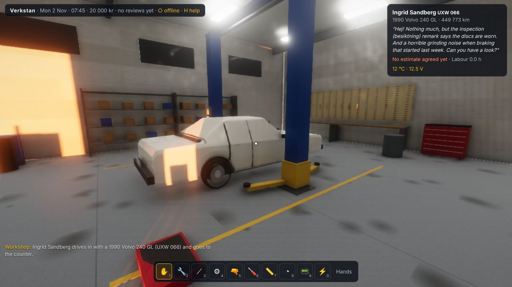
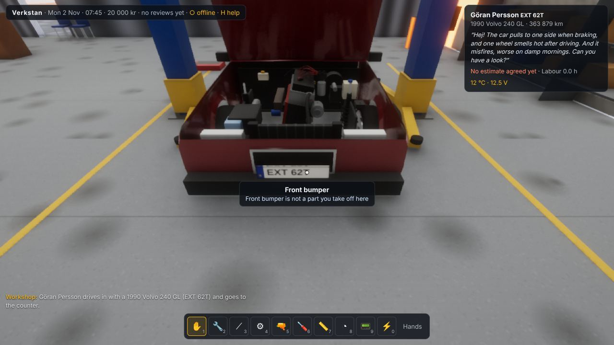
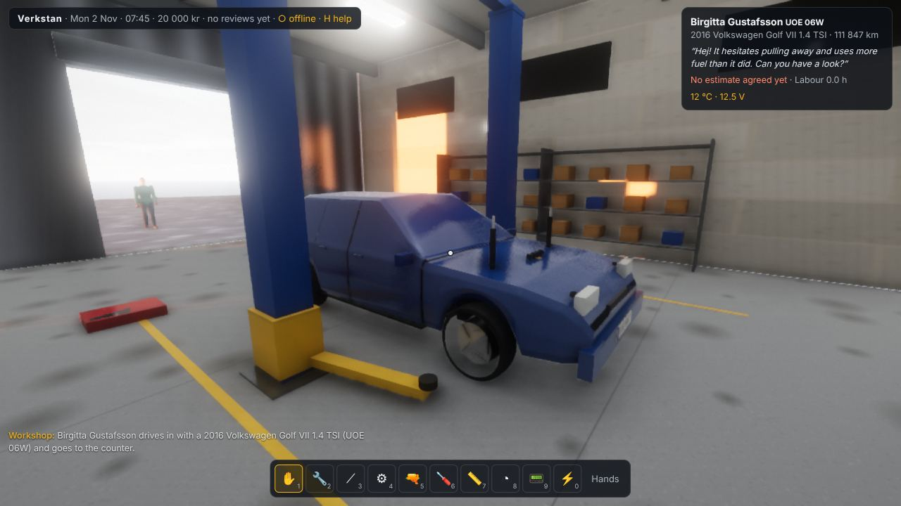
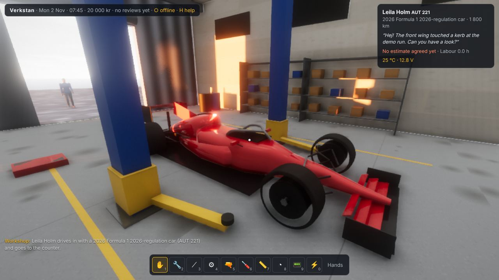
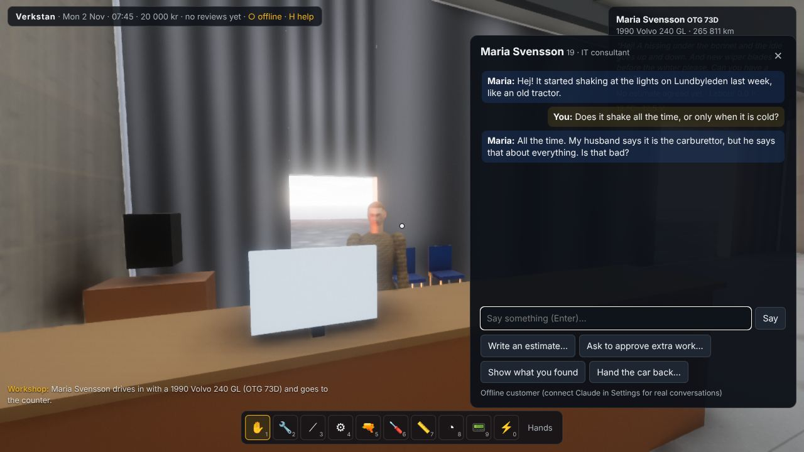
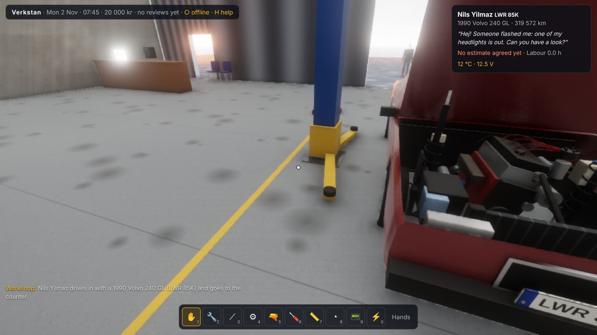

# Verkstan

Monday 2 November 2026, a grey morning on Hisingen in Gothenburg, four weeks before winter tyres
become law. You run Verkstan, a one-bay independent workshop: a two-post lift, a workbench, a
roll cab, a parts shelf and a tyre hotel. Customers walk in with whatever is wrong with their car.
**The customers are Claude.** Each one is invented on arrival: who they are, how they talk, what
really happened to the car, what they will and will not tell you. The car's real faults are chosen
from the workshop's catalogue and written into its simulated parts. You find them by asking,
listening, measuring and taking things apart, and you fix them with your own hands and real tools.

It runs on the Med Engine, the WebGL2 deferred renderer of *Zweikampf 1403* (`games/duel1403`,
imported read-only), set up the way *Glass Elevator*, *Gotthard Pullman* and *Fleet Boat* set it
up. The people are the 1403 `Walker` figures that all those games use, with Gotthard's reaching
hands.

| A Volvo 240 in the bay, morning sun through the door | Its B230F under the bonnet |
| --- | --- |
|  |  |
| **A Golf VII between the posts** | **A 2026-regulation F1 car (the ERS light is red: live)** |
|  |  |
| **At the counter** | **Bonnet up, struts and leads** |
|  |  |

## Run it

```bash
cd games/verkstad
npm install
ANTHROPIC_API_KEY=sk-ant-... npm run dev   # http://127.0.0.1:5190 — customers played by Claude
npm run dev                                # without a key: paste one in Settings, or play offline customers
npm test                                   # the car model, faults, fasteners, engine, oil
node tools/playtest.mjs                    # a whole front brake job, headless, through the game's own hands
```

With `npm run dev` the page talks to `/claude/*` and the dev server forwards that to
api.anthropic.com with the key from your shell, so the key never reaches the browser. In Settings
(the ● in the top bar) you can instead paste your own key, which is kept only in that browser's
localStorage and sent only to the API. You can also choose the model: Claude Opus 5.5 (the default),
Sonnet 5.5 or Haiku 5.5. A customer costs roughly 20 US cents on Opus 5.5 and well under a cent on
Haiku 5.5 (an estimate; the Settings panel counts the tokens). The rules and the fault catalogue are
the same in every call and are prompt-cached. Without any key the game plays **offline customers**:
the same faults and the same rules, but canned words.

| Key | |
| --- | --- |
| Mouse | look (click the view to hold the mouse, Esc lets go) |
| W A S D · Shift · C | walk · hurry · crouch, lie on the creeper (to get under a car on its wheels), stand |
| Left button | hands and tools on what you look at: take off, put on, open, turn, measure. **Hold and drag** to turn a spanner |
| 1–0 · T | tools (hands, ½" ratchet, breaker bar, torque wrench, impact gun, screwdrivers, tread gauge, tyre gauge and air line, scan tool, multimeter) · the roll cab with all of them |
| Wheel · Shift+wheel · R | socket size · torque wrench setting · undo / do up |
| Q · B · G | put down what you hold · a brick on the brake pedal (holds the wheels) · rev the engine |
| E | the customer: talk, estimate, phone about extra work, show what you found, invoice and hand back |
| H | help |

## How a job goes

1. A car rolls in through the roller door and its owner walks to the counter. **Talk to them.**
   Ask what happens, when, since when, what they did about it. Claude answers in character and
   reveals the story the way a person would. They don't know the technical cause. They may be
   wrong about it, may have hit a kerb they won't mention, or may have let their son borrow the car.
2. **Give an estimate.** Labour is 1 095 kr an hour; parts are at retail. Under
   *konsumenttjänstlagen* you may not charge more than about 15 % over it without asking, so if
   you find more, **phone them** and they decide (yes or no, in character).
3. **Find the fault.** Lift the car: swing all four arms under the jacking points first. With
   fewer, it comes off the lift, and that is on you. Then look, listen and measure. The engine is
   simulated cylinder by cylinder, so a dead coil is a missing beat you hear and a shake you see.
   On the Golf, the scan tool shows P0302 and the misfire counters. On the 1990 Volvo there is no
   OBD, so you count the blink codes on its LH-Jetronic diagnostic unit, or find the dead
   cylinder the old way: pull the HT leads one at a time with the engine running and hear which
   one makes no difference.
4. **Fix it.** Parts come off in the order a real car allows: the wheel before the caliper, the
   caliper (or the Volvo's pad pins) before the pads, the carrier before the disc. Every fastener
   needs the right socket and comes off with the torque it takes. Rusted ones need the breaker
   bar, penetrating oil and a few minutes. Put it back with the torque wrench until it clicks at
   the spec. Take new parts from the shelf.
5. **Hand it back.** The invoice is filled in from the new parts and the hours on the workshop
   clock (you can change it). The customer drives it round the block, and the simulation decides
   what they notice. Claude decides what they say, what they pay and how many stars they give.

## What is modelled

All the car data is in `src/data/cars.js` and `src/car/assembly.js`. Where a number came from a
source, `docs/references.md` says so. Where it didn't, it says that too.

### The cars (`src/car/`)

- **1990 Volvo 240 GL** (B230F, LH-Jetronic 2.4, M47 gearbox, rear-wheel drive on a live axle):
  fixed four-piston front calipers with pad retaining pins, 263 × 24 mm vented front discs, 19 mm
  wheel nuts at 115 N·m, a distributor with cap, rotor and four HT leads, firing order 1-3-4-2,
  plugs gapped 0.7 mm, 3.85 l of 10W-40.
- **2016 Volkswagen Golf VII 1.4 TSI** (EA211, 92 kW, front-wheel drive, torsion-beam rear):
  floating calipers on carriers, an **electric parking brake** that has to be wound back with the
  scan tool before the rear pads come out, coil-on-plug ignition, 17 mm wheel bolts at 120 N·m,
  OBD-II, indirect tyre-pressure warning, bulb monitoring.
- **A 2026-regulation Formula 1 car**: 3.4 m wheelbase, 1.9 m wide, 768 kg; a carbon survival cell
  and halo; a 1.6 l V6 turbo with a 350 kW MGU-K; centre-lock wheels on a wheel gun; carbon
  brakes; 18-inch slicks (280 front, 375 rear). It has **no jacking points**: the lift's arms
  would crack its floor, so it goes up on F1 jacks. It cannot be started with a key. It needs the
  heater cart and an external starter. Its ERS light must be green before you touch it, and
  insulated gloves isolate it.
- Each road car is **about 135 separate parts and 50–85 fasteners** (the F1 car 43 and 20), each with a part number, mass,
  price and condition. Wheels, discs, calipers, carriers, pads, pins, hoses, hubs, struts,
  springs, arms, ball joints, anti-roll bar links, track rods and CV boots. The engine, sump plug,
  oil filter, dipstick and filler cap; plugs, coils or leads, distributor cap and rotor. Air box,
  filter, air mass meter, breather hose; battery, alternator, belt, tensioner, starter; radiator,
  fan, thermostat and its housing, expansion tank; brake servo and reservoir; washer bottle;
  manifold, lambda sensor, front pipe, silencer, fuel tank. Fuse box and fuses; headlamps, tail
  lamps and their bulbs; wiper blades; dashboard, instrument cluster, steering wheel, ignition
  lock, bonnet release, handbrake, gear lever, seats and carpet.
- The **body** is one smooth surface, lofted from each car's silhouettes and cut into its real
  panels (bonnet, boot lid or tailgate, four doors) with shut lines and wheel arches. The
  panels open on their hinges. Glass is one-sided, so it's dark from outside and clear from inside.

### The simulation (`src/sim/`)

- **The engine** (`engine.js`), cylinder by cylinder at 2–4 kHz. Each cylinder's compression and
  expansion (a gas spring) and combustion torque pulse comes at its place in the firing order,
  with friction and pumping losses rising with speed and cold. The starter is a series motor fed
  through the battery's internal resistance, so a weak battery cranks slowly. The ECU is modelled
  too: it needs to sync on the crank before it fires, it holds idle speed with a PI loop (fast
  idle when cold), it runs closed-loop fuel trims from the lambda sensor that catch unmetered air,
  and it detects misfires from crankshaft acceleration per power stroke, the way real ECUs do.
  There is a rev limiter, and coolant warms through a thermostat into the radiator. The engine
  rocks on its mounts with every firing, and harder when it misfires.
- **The car** (`vehicle.js`). The battery's state of charge and resistance; an alternator
  regulated to 14.2 V that needs its belt. Warning lamps; the Golf's OBD-II fault memory and live
  data; the Volvo's LH 2.4 / EZ-116K blink codes. Oil that runs out of the drain hole faster when
  hot, into the drain pan if it is under the plug, onto the floor if not. The dipstick reading,
  coolant and brake fluid levels, tyres losing air through a nail, brake drag when you spin a
  wheel by hand. And the **road test**: what a driver notices on a drive round the block.
- **Fasteners** (`fastener.js`). Threads engage over turns, run down on friction, then stiffen
  past seating, so torque climbs with angle. Breaking one loose takes the clamp plus rust. Past
  yield it stretches; further, it snaps. The torque wrench clicks at its setting. An impact gun
  driven home over-torques a wheel nut.

### The faults (`src/data/faults.js`)

Thirty-eight faults and four jobs, each a change to real part conditions, so everything that
follows comes out of the simulation:

- **Brakes:** pads worn to the indicator or through to the metal (scoring the disc), discs with
  runout or below minimum thickness, seized calipers, wet brake fluid.
- **Wheels and tyres:** a nail in the tread, tyres below 1.6 mm, a wheel out of balance, wheel
  nuts left loose by another garage.
- **Ignition and fuel:** a dead coil (Golf), a broken HT lead or cracked distributor cap
  (Volvo), worn or fouled plugs, vacuum leaks, a blocked air filter, a dead lambda sensor or air
  mass meter.
- **Cooling:** a thermostat stuck open, low coolant.
- **Charging and starting:** a sulfated battery, an alternator that has stopped charging, a
  glazed belt, burnt starter solenoid contacts.
- **Electrics and small parts:** blown bulbs and fuses (sometimes a coin wedged in the 12 V
  socket), worn wipers.
- **Suspension and drive:** anti-roll bar links, ball joints, wheel bearings, torn CV boots.
- **Exhaust and oil:** a rusted silencer, low oil, a drain plug weeping through a reused crush
  washer.
- **On the F1 car:** a damaged front wing, worn carbon pads.
- **Jobs:** an oil service, winter tyres from the tyre hotel, new wipers, a fresh set of slicks.

Claude chooses among them for each customer, and can leave things in cars: a mouse nest in the
air box, a lost wedding ring under the seat.

## Tests

`npm test` checks:

- every car builds, with every blocker a real part;
- wheels only come off in the air and with their nuts out;
- the pads only come out after what is in front of them;
- the Golf's rear calipers refuse to come off without EPB service mode;
- torque-wrench clicks, seized fasteners needing the breaker bar, an impact gun stretching a stud;
- every fault applies to its cars and is cured by new parts or by putting things right;
- the Golf starts and idles on three cylinders and sets P0352 and P0302;
- the Volvo's dead lead is found by pulling leads with the engine running;
- oil drains through the plug hole into the pan.

`node tools/playtest.mjs` does a complete front brake job in the browser.

## Not yet

This is the first version. The things that would make it bigger next, roughly in order:

- **A test drive** out of the yard (the analytic road test stands in for it now).
- Deeper engine work: the cam cover, the timing belt (the B230F's is non-interference), head
  gaskets, compression test readings in the bay.
- A tyre machine (beads on and off the rim), a brake lathe, an engine crane.
- More cars: a Tesla Model 3 (high voltage at 400 V), a Saab 9-3, a Volvo XC90, a Ford Transit
  van.
- Touch controls.
- Several customers waiting at once, and a second bay.
- Claude inventing new failure modes beyond the catalogue. Today it chooses from 42, which keeps
  every fault physically real.
