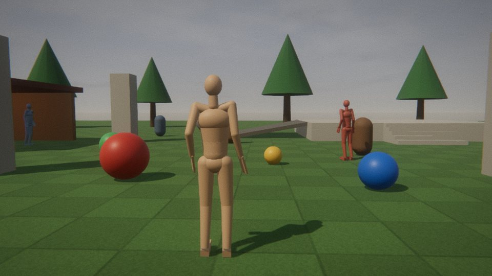
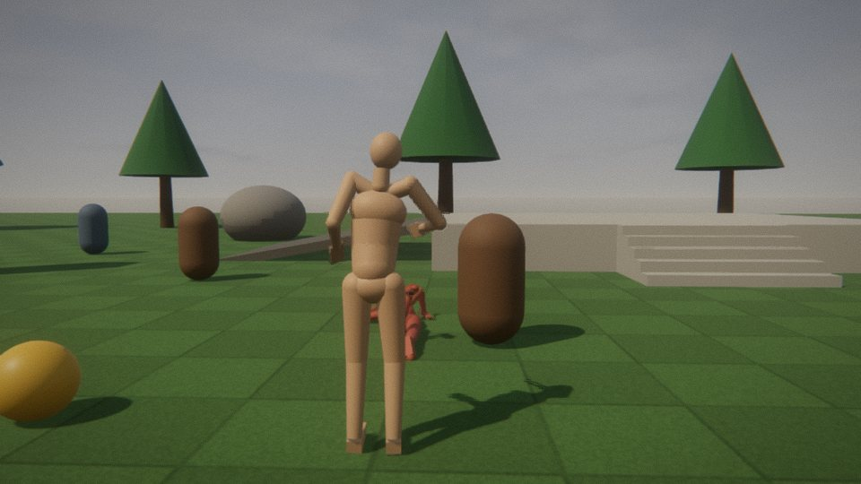
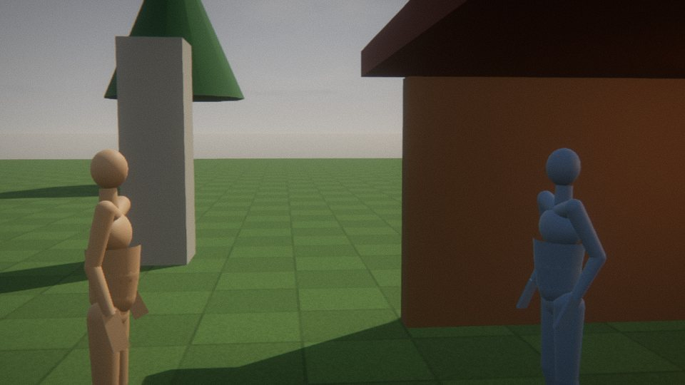

# Med Engine 3



Med Engine 3 is a game engine that owns its whole stack. It has its own math and scene graph, a deferred renderer written for
WebGPU in WGSL, motion-capture animation with a clip state machine, physics, input, an asset pipeline, a story runner, a
virtual cinematographer, and a platform layer. That layer runs the same game in a browser, headless on Node, and natively on
Deno, either as a script or as one executable file.

It has no dependencies. three.js is gone, and so is WebGL.

- **Run the demo:** `npm run demo` (nothing to install), then open http://localhost:8080/ in a browser with WebGPU (Chrome or
  Edge 113+, Safari 26, Firefox 141+ on Windows). Click to capture the mouse. WASD moves, Space jumps, F punches, G kicks, E talks to the
  ferryman in the hut, C cycles the film cameras, R resets.
- **Read on:** [engine and stage](docs/ENGINE.md) · [animation](docs/ANIMATION.md) · [camera and shots](docs/CINEMA.md) ·
  [physics](docs/PHYSICS.md) · [input](docs/INPUT.md) · [assets](docs/ASSETS.md) · [story](docs/STORY.md) ·
  [platforms and native](docs/PLATFORM.md) · [performance](docs/PERFORMANCE.md) · [TypeScript](docs/TYPES.md)

## A small game

```html
<canvas style="width:100vw;height:100vh;display:block"></canvas>
<script type="importmap">
  { "imports": { "medengine": "/node_modules/medengine/src/index.js",
                 "medengine/platform/browser": "/node_modules/medengine/src/platform/browser.js" } }
</script>
<script type="module" src="main.js"></script>
```

```js
// main.js
import { Engine, Mesh, PlaneGeometry, StandardMaterial, DirectionalLight, PlaneCollider, Vector3, Actor, Director, loadClipLibrary } from 'medengine';
import { BrowserPlatform } from 'medengine/platform/browser';

const canvas = document.querySelector('canvas');
const engine = await Engine.create({ platform: new BrowserPlatform({ canvas }), input: { lockOnClick: true } });
const { scene, physics, input } = engine;

// the ground: something to see, and something to stand on
const ground = new Mesh(new PlaneGeometry(40, 40), new StandardMaterial({ color: 0x6f8f55, roughness: 0.95 }));
ground.rotation.x = -Math.PI / 2;
ground.receiveShadow = true;
scene.add(ground);
physics.addCollider(new PlaneCollider(new Vector3(0, 1, 0), 0));
const sun = new DirectionalLight(0xfff2dd, 7);
sun.position.set(5, 10, 4);
scene.add(sun);

// a motion-captured mannequin with a physics capsule, and a camera that follows it
const clips = await loadClipLibrary(engine.assets, '/node_modules/medengine/assets/anim/humanoid');
const hero = engine.add(Actor.mannequin({ clips }));
hero.root.traverse((part) => { part.castShadow = true; });
hero.attachCharacter(physics);
const director = engine.add(new Director(engine));
director.followActor(hero);

input.map({
  move: { type: 'vec2', up: ['KeyW'], down: ['KeyS'], left: ['KeyA'], right: ['KeyD'], stick: 'Pad:ls' },
  look: { type: 'look', mouse: 'locked', stick: 'Pad:rs' },
  jump: ['Space', 'Pad:a'],
});
engine.add({
  fixedUpdate() {
    if (input.pressed('jump')) hero.jump();
    const m = input.vec2('move'), yaw = director.yaw, speed = 3.5;      // the stick is relative to where the camera looks
    hero.move((Math.sin(yaw) * m.y - Math.cos(yaw) * m.x) * speed, (Math.cos(yaw) * m.y + Math.sin(yaw) * m.x) * speed);
  },
  update() {
    const look = input.look('look');
    director.look(look.x, look.y);
  },
});
engine.start();
```

The same engine headless on Node renders into an offscreen texture. This is how the tests, the benchmark and the screenshot
tool run:

```js
import { Engine, Mesh, BoxGeometry, PlaneGeometry, StandardMaterial, DirectionalLight } from 'medengine';
import { NodePlatform } from 'medengine/platform/node';          // needs the optional `webgpu` package: npm i webgpu

const engine = await Engine.create({ platform: new NodePlatform({ width: 1280, height: 720 }) });
const ground = new Mesh(new PlaneGeometry(20, 20), new StandardMaterial({ color: 0x6f8f55 }));
ground.rotation.x = -Math.PI / 2;
const crate = new Mesh(new BoxGeometry(1, 1, 1), new StandardMaterial({ color: 0xb4ae9f, roughness: 0.6 }));
crate.position.set(0, 0.5, 0);
crate.castShadow = true;
const sun = new DirectionalLight(0xfff2dd, 7);
sun.position.set(4, 8, 3);
engine.scene.add(ground, crate, sun);
engine.camera.position.set(3, 2, 4);
engine.camera.lookAt(0, 0.5, 0);
engine.run(30);                                   // 30 frames of 1/60 s, deterministic: the temporal filter settles
await engine.screenshotPNG('frame.png');
engine.dispose();
```

Both programs are checked: they compile under TypeScript's `strict` against the shipped declarations, and the Node one was run
and wrote its picture.

## What is in it

| Part | What it does |
| --- | --- |
| `math/`, `scene/` | Vectors, matrices, quaternions, colours, frustums and rays. A scene graph of objects, meshes, skinned and instanced meshes, cameras, lights and materials. Geometry builders. |
| `render/`, `gpu/` | A WebGPU deferred renderer. Sun shadow cascades, a high-resolution focus shadow and contact shadows; a G-buffer; tiled point, spot and tube lights (up to 256, culled per tile, with spot shadows in an atlas); image-based sky light. Then skin subsurface scattering, temporal anti-aliasing with upscaling, auto exposure, bloom, and a film composite (tonemap, colour grade, grain). Four quality tiers. GPU timing per pass. |
| `engine/` | The loop: fixed 60 Hz simulation steps with interpolation, systems with hooks, pause and slow motion, deterministic `run()`, screenshots. |
| `anim/` | BVH motion-capture import, retargeting onto the engine's skeleton, baking to compact `.medclip` files, an animator with layers, bone masks and additive clips, and a state machine with 1D/2D blend trees, conditions, triggers and synced transitions. Nine clips ship baked. |
| `human/` | `Actor`: a character that walks, runs, turns, jumps, plays clips over its locomotion, looks at things, emotes and lip-syncs, rides a physics capsule, falls as a ragdoll and gets up. Loaders for the MakeHuman-built characters of Med Engine 2 and for glTF characters. |
| `physics/` | Rigid bodies (spheres and capsules), static colliders (plane, box, sphere, capsule, triangle mesh with a bounding-volume tree), ball and hinge joints with limits, a character controller (steps, slopes, pushing), ragdolls, triggers, and ray, sphere and overlap queries. |
| `input/` | Keyboard, mouse (with pointer lock) and gamepads as named actions (buttons, axes, 2D movement, look), contexts, rebinding with "press a key", saved bindings, and recording and replay. |
| `assets/` | One loader for everything: glTF/GLB, OBJ/MTL, images, JSON, text, clips, clip libraries and BVH. Caching, sharing, progress and manifests. |
| `story/` | A data-driven branching story runner: scenes, timed choices, quick-time events, negotiations, exploration, branches, random outcomes and endings. A safe expression language, saves, a flowchart, and a fuzzer that plays it thousands of times. |
| `cinema/` | The Director: a third-person follow camera with wall collision, and film shots (ECU to EWS, over-the-shoulder, two-shots, POV, inserts) with lenses in mm and camera moves. |
| `platform/` | The only code that knows where it runs: `BrowserPlatform` (canvas, DOM events, gamepads, fetch), `NodePlatform` (Dawn, offscreen), `DenoPlatform` (wgpu, offscreen or a native window). |
| `audio/`, `ai/` | Procedural sound and the Claude bridge, carried over from Med Engine 2 unchanged (browser only). |

The demo level, **The Ford** (`demo/`), puts the parts together. It is a meadow with a hut, stairs, a ramp, balls and barrels to kick,
a dummy to knock down, and a ferryman who tells a branching story. `demo/game.js` never touches the DOM, so the same level runs in
the page, headless in the tests, and natively (`native/`).

| | |
| --- | --- |
|  |  |

## The list, item by item

| # | Asked for | Where it stands |
| --- | --- | --- |
| 1 | Mocap retargeting + clip state machine | **Done.** BVH → retarget → bake (`npm run bake:anim`) → `Animator` + `StateMachine` → `Actor`. Nine clips ship: eight are CMU motion capture (walk, run, jump, punch, kick, bow, wave, get-up), and an idle is made from a captured standing pose. See the limits below. |
| 2 | Input system | **Done.** `InputManager`: keyboard, mouse, gamepad, actions, contexts, rebinding, saving, replays. No touch controls. |
| 3 | Physics: capsule collision + ragdoll | **Done**, and more: rigid bodies, joints, a character controller, ragdolls with get-up, triggers, queries. |
| 4 | Runnable demo scene | **Done.** `npm run demo`. It is tested in a real Chromium with WebGPU (keys, mouse clicks, the HTML panel, pixels). |
| 5 | Asset pipeline | **Done.** `AssetManager` with the glTF, OBJ, image and clip loaders. glTF support is listed in [docs/ASSETS.md](docs/ASSETS.md). |
| 6 | The story runner | **Shipped** in `src/story/`. The Med Engine 2 README claimed it, and now the package has it. |
| 7 | Real GPU benchmarking | **The tools are ready; the numbers are not.** `npm run bench`, `bench/` in a browser, per-pass GPU timers, and `?gpu=1` in the demo. Every number measured here came from SwiftShader, a CPU pretending to be a GPU. **Run it on your GPU:** [docs/PERFORMANCE.md](docs/PERFORMANCE.md). |
| 8 | Types/docs on the public API | **Done for Stage, Actor and Director** (no `any`, apart from Actor's custom event payloads), and for the Engine, physics World, math, geometry and story fuzzer. The rest has declarations with some `any` left. TypeScript declarations are generated from the source's doc comments; see [docs/TYPES.md](docs/TYPES.md). |
| 9 | Better face meshes (scans) | **Not done.** The hook is there: `attachScanHead()` prepares a scanned glTF head with ARKit face shapes for the face system. No scans ship, though. Photogrammetry needs capture data that cannot be made here. |
| 10 | WebGPU renderer, own scene graph and platform layer, packaging | **Done.** WebGPU only, its own scene graph and math, `Platform` for window, input, timing and files, an exports map, `npm run build`, and `deno compile` for one executable. |

## What is not done, plainly

- **Performance on real GPUs is unmeasured.** Every frame in this repository was rendered by SwiftShader. Measure on your own hardware before believing any frame rate.
- **Renderer passes from Med Engine 2 that are not ported yet:** SSAO, SSR and SSGI, volumetric light and fog, rain and the weather system, GPU particles, the probe volume, virtual shadow maps, ray tracing, the visibility buffer, Gaussian splats, depth of field and motion blur. Some API is kept for them and does nothing yet: `stage.lens` and `Light.volumetric` hold values that no pass reads, and `Sprite` objects are not drawn. Wet surfaces do work: set `stage.renderer.wetness` (and `rain` for ripples and running water).
- **Transparency is dithered:** see-through materials are stochastic and smoothed by the temporal filter. That works for fades, hair and foliage, but there is no blended glass.
- **The picture is brighter than Med Engine 2's**, because the output is now encoded to sRGB correctly. Re-grade old scenes rather than trusting their numbers.
- **Animation:**
  - Feet slide a little: the median is about 0.1 to 0.17 m/s. There is no foot IK.
  - The idle is procedural.
  - There is no face-up get-up clip: a ragdoll lying on its back rises with a 1.2-second procedural motion.
  - A glTF or other rig must use Med Engine's bone names in a world-aligned rest pose, or have clips baked for it.
- **Characters:** `Humanoid` is a mannequin for tests and demos. No character models ship, and Med Engine 2 shipped none either: its `tools/human/` builders turn your MakeHuman data into characters. The `Human` loader is tested against a synthetic character in the same file format (21 tests, which caught 10 of 10 deliberately injected loader bugs), **not against a real MakeHuman export**.
- **Physics:**
  - There is no continuous collision detection.
  - `sphereCast` is marched, so it can step over very thin geometry. The follow camera's wall check uses it.
  - Characters do not ride moving platforms.
  - The limbs of one ragdoll do not collide with each other.
  - Joint cone limits are symmetric.
  - Rigid bodies are spheres and capsules only.
- **Native window:** `DenoPlatform`'s window mode (`deno desktop`) is written against Deno's documentation but has **never run**, because there is no display here. Its headless mode and `deno compile` executables are tested. See [native/README.md](native/README.md).
- **Browser testing** used headless Chromium on SwiftShader. That means no real GPU, no real display, no pointer lock and no audio output. The demo needs a keyboard and mouse, or a gamepad.
- **Audio and Claude** are Med Engine 2's modules, carried over unchanged and not tested in Med Engine 3 beyond starting the audio once in the browser test.

## Coming from Med Engine 2

| Med Engine 2 | Med Engine 3 |
| --- | --- |
| WebGL2, three.js as the scene graph | WebGPU and WGSL; its own math (`math/`) and scene graph (`scene/`). Familiar names, such as `Vector3`, `Object3D` and `MeshStandardMaterial`, are kept so code ports with fewer edits. |
| `new Stage(canvas, o)` | `await Engine.create({ platform, ... })` (or `await Stage.create({ platform })` on its own) |
| `stage.render(dt)` in your own loop | `engine.start()`, with systems (`fixedUpdate` / `update` / `lateUpdate`), or `engine.run(frames)` |
| `Actor.load(stage, dir, name)`: posed with `Rig` / `Pose` / `Moves` | `Actor` driven by motion capture: `Actor.load(engine, 'x.glb')`, `new Actor(human, { clips })` or `Actor.mannequin()`; `actor.play()`, `walkTo()`, `move()`, `lookAt()`, `emote()`, `say()` |
| `director.update(dt)` | `director.advance(dt)`, or add the director to the engine and it runs itself |
| `followActor` framing `{ dist: 2.6, height: 0.35, lens: 32 }` | The new defaults frame the whole body (`dist 3.2, height -0.3, shoulder 0.45, pitch -8, lens 28`). Pass the old values for the old look. |
| Physics lived in engine 1 only | `physics/` is back and bigger |
| No input code | `input/` |
| Per-game loading | `assets/` |
| The story runner in the README only | `story/` |
| `world/Kit.js` (materials, props, skylines), `world/Packed.js` (base64 packing for artifacts) | **Not ported.** |
| `weather/Rain.js`, `weather/Weather.js` | **Not ported.** Wet surfaces survive in the material shader. |
| `human/Garments.js`, `human/Cloth.js`, `passes/GPUCloth.js` | **Not ported:** no layered clothes, capes or cloth |
| `human/Rig.js`, `Pose.js`, `Moves.js` | **Replaced** by motion capture (`anim/`) |
| `passes/ScreenSpace.js`, `Volumetrics.js`, `Cinematic.js` (DOF, motion blur), `GPUParticles.js`, `GaussianSplats.js`, `RayTracing.js`, `VirtualShadows.js`, `VisBuffer.js`, `Sprites.js`, `Debug*.js` | **Not ported** (see above) |
| `gi/ProbeVolume.js`, `vt/VirtualTexture.js`, `geometry/` (cluster LOD, simplification, terrain), `scene/BVH.js` | **Not ported** |
| `passes/SkinSSS.js`, `TAA.js`, `Post.js`, `Shadows.js`, `Environment.js`, `lights/LightGrid.js` | **Rewritten for WebGPU** in `render/passes/` |
| `human/Human.js`, `Face.js`, `Subdivision.js`; `cinema/`; `audio/`; `ai/` | Carried over: `Human` and `Face` are adapted to the new animation, and `audio` and `ai` are unchanged |

## Conventions

The world is right-handed: +Y is up, units are metres, seconds and radians, unless a name says degrees (`yawDeg`) or millimetres
(`lens`). Cameras look down −Z. A character faces +Z, and its left is +X. Matrices are column-major `Float32Array(16)`. The main
view uses reversed Z. Colours are sRGB in (`0xb4ae9f`, CSS names) and linear inside.

## Commands

| | |
| --- | --- |
| `npm run demo` | Serve the package and open the demo at http://localhost:8080/ (`?quality=low…ultra`, `?scale=0.6`, `?gpu=1`) |
| `npm test` | Unit tests on Node: no GPU needed (266 tests) |
| `npm run test:gpu` | Rendering tests on Node with Dawn; with no GPU they fall back to SwiftShader (33 tests) |
| `npm run test:browser` | The demo and the benchmark page in headless Chromium with WebGPU (6 tests) |
| `npm run test:deno` | `DenoPlatform` headless on Deno's own WebGPU (3 tests) |
| `npm run bench` | The benchmark on your GPU ([docs/PERFORMANCE.md](docs/PERFORMANCE.md)) |
| `npm run shots` | A scripted tour of the demo saved as PNG files, headless |
| `npm run native` | The demo as a native Deno program ([native/README.md](native/README.md)) |
| `npm run build` | `dist/medengine.min.js`: the engine and the browser platform in one file, about 460 KB (160 KB gzipped) |
| `npm run types` | Regenerate the TypeScript declarations from the doc comments |
| `npm run bake:anim` | Re-bake the motion-capture clips from `assets/mocap/` |

`npm install` only installs development tools: esbuild for the build, TypeScript for the declarations, and `webgpu`, which is
Dawn for Node, for headless rendering. The engine itself needs none of them. The tests ran on Node 22, Deno 2.9 and Chromium's
SwiftShader.

## Layout

```
medengine/
  src/          the engine (about 20,000 lines). index.js is the root; every folder has its own index.js
  types/        TypeScript declarations, generated from src/ (npm run types)
  assets/       anim/humanoid (the baked clips), mocap/cmu (their BVH sources and credits), story/ford.story.json
  demo/         The Ford: index.html + main.js (the page), game.js (the level), screenshot.mjs (the tour)
  bench/        the benchmark: bench.mjs (Node), index.html (browser), scenes.js (shared)
  native/       the demo as a Deno program and executable
  tools/        serve, build, types, bake-anim, trim-bvh, software-gpu, human/ (the MakeHuman character builder)
  tests/        node --test: *.test.js (unit), gpu/, browser/, deno/, types/usage.ts
  docs/         the guides linked above
```

## Credits

Motion capture comes from the CMU Graphics Lab Motion Capture Database (mocap.cs.cmu.edu), created with funding from NSF
EIA-0196217, in Bruce Hahne's MotionBuilder-friendly BVH conversion. CMU places no restrictions on its use. See
`assets/mocap/cmu/README.md`.
